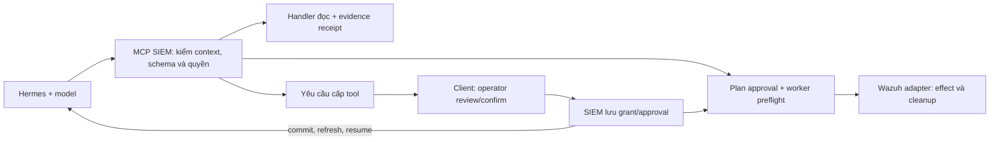

# Kế hoạch agent điều tra và khắc phục có phê duyệt

Ngày chốt: **2026-11-16** (Asia/Saigon). Baseline: `main@7628921f2ba871d9f8b29499f68a293819647a56`.

Điều chỉnh kiến trúc ngày **16/11/2026**, đối chiếu `main@baa7192`: Hermes Agent điều phối qua MCP; backend SIEM quản lý catalog và quyền tool, client xác nhận khi cần cấp thêm khả năng. Không đổi baseline thực nghiệm lịch sử.

Trạng thái: **ĐÃ THỐNG NHẤT HƯỚNG THIẾT KẾ / CHƯA TRIỂN KHAI**. Lượt này cập nhật kế hoạch và scope issue; không cấp quyền cho phần mềm thực thi hành động trên lab. Mọi mục R0–R6 bên dưới đều chưa nghiệm thu trong tài liệu này.

Tài liệu triển khai bổ sung: [hướng dẫn giải quyết 17 issue R0–R6](approval-remediation-implementation-guide.md), gồm dependency, điểm sửa trong code, phương án, kiểm thử và điều kiện đóng issue; theo dõi tại [Epic #10](https://github.com/haizzdungnay/local-ai-siem-analyzer/issues/10). Hướng dẫn cũng đối chiếu phần phối hợp #23 và review playbook #29.

## 1. Mục tiêu và quyết định phạm vi

Mở rộng mô-đun AI local thành vòng xử lý: yêu cầu của người vận hành → điều tra có bằng chứng → đề xuất kế hoạch → duyệt hai bước qua Telegram hoặc trang web từ email → thực thi có giới hạn → kiểm chứng → báo cáo và hoàn tác.

- Làm agent điều tra chỉ đọc trước, sau đó bổ sung executor khắc phục có phê duyệt.
- Hermes Agent là lớp điều phối model/tool; MCP server SIEM gọi handler đã đăng ký. Policy, cấp quyền, bằng chứng, approval và executor thuộc backend SIEM.
- Khởi đầu bằng tool cơ bản có scope cố định; sau R2, agent có thể dùng `request_tool_access` để xin thêm tool trong catalog. Client xác nhận, backend ghi quyền rồi Hermes cập nhật schema và tiếp tục request còn hạn.
- Telegram là kênh tương tác MVP; email thông báo và dẫn tới trang duyệt có xác thực ở giai đoạn tiếp theo.
- Hai bước duyệt: **Duyệt kế hoạch** rồi **Xác nhận thực thi** trên cùng phiên bản và nội dung. Hai lần bấm không được coi là hai yếu tố xác thực.
- Mỗi thay đổi có ý nghĩa về hành động, đích, tham số, quyền, ảnh hưởng hoặc hoàn tác phải tạo phiên bản mới và xin duyệt lại.
- LLM đề xuất action ID và tham số có cấu trúc. Executor chỉ nhận hành động từ registry do code quản lý; không chạy shell/script do model hay alert sinh ra.
- MVP thực thi duy nhất `block_source_ip_temporary` trên một victim Linux lab; thời hạn mặc định 300 giây, trần MVP 600 giây. Thu thập bằng chứng là quyền đọc riêng, không phải hành động khắc phục.
- Khóa tài khoản, cô lập máy, sửa cấu hình thật, xóa file, restart dịch vụ và nhiều máy cùng lúc nằm ngoài MVP; chỉ mở sau nghiệm thu riêng.
- Giữ phân biệt **containment tạm thời** với **khắc phục nguyên nhân gốc**. Chặn IP thành công không chứng minh đã loại bỏ xâm nhập.

Quyết định này mở một giai đoạn có ghi mới, sau quyết định agent chỉ đọc trong HANDOFF ngày 07/11. Runtime hiện tại vẫn giữ hành vi cũ cho tới khi các gate triển khai đạt. Không thay đổi model mặc định, rule, cổng hay trạng thái lab trong commit kế hoạch.

## 2. Hiện trạng đã đối chiếu với code

| Thành phần | Đang có tại baseline | Cần bổ sung |
|---|---|---|
| Nguồn bằng chứng | `reader.py`, Wazuh Indexer/OpenSearch `:9200` | Truy vấn điều tra cố định, ngân sách và evidence snapshot |
| Phân tích | `analysis_service.py`, `llm.py`, playbook exact lookup cho từng alert | Kế hoạch máy đọc được và tích hợp phân tích cửa sổ |
| Điều phối/tool call | Gọi Ollama lấy JSON; chưa có vòng `tool_calls`, Hermes hoặc MCP | Hermes profile giới hạn tool và adapter MCP vào service SIEM |
| Playbook | 28 bản draft; 3 bản có signals | Review trên lab, điều kiện bằng chứng và action mapping |
| Trạng thái | `dashboard_store.py`, SQLite schema v9, job/review/delivery | Bảng request/plan/approval/execution và tool access/grant, migration cộng thêm |
| Telegram | `telegram_notifier.py`: gửi report/test, chưa nhận callback | Poller nhận update, binding người duyệt, xác nhận hai bước |
| Gmail | `gmail_notifier.py`: SMTP outbound | Email kế hoạch và link tới trang duyệt; không đọc email trả lời |
| Web | Flask/Waitress loopback, Host/Origin checks | Danh tính operator, session, CSRF; client duyệt cấp tool và kế hoạch |
| Thực thi | Chưa có executor khắc phục | Adapter Wazuh Active Response được giới hạn và kiểm thử |

Wazuh Manager API `:55000` nếu dùng để dispatch Active Response là đường điều khiển riêng; alert vẫn đọc từ Indexer `:9200`. Phải xác minh phiên bản Wazuh, API, script và quyền tối thiểu trên lab trước khi chốt adapter; tài liệu này không giả định endpoint/rollback đã chạy được.

CI cho bản sửa `71787ec` đã được upstream ghi nhận xanh 4/4 matrix. Các lỗi correctness, SFT leakage và thiết kế phép thử B/C chưa vì thế được coi là đã sửa. SFT leakage là gate trước huấn luyện; việc này không thay thế gate an toàn executor.

## 3. Luồng sử dụng đã chốt

1. Operator chọn cảnh báo/job và bấm **Yêu cầu điều tra và lập kế hoạch**. Tự động phát hiện cảnh báo chỉ được tạo thông báo/đề xuất theo cấu hình; không tự cấp quyền ghi.
2. Hermes chọn tool cơ bản qua MCP trong scope request: đúng agent, khoảng thời gian và ngân sách. Thiếu tool đã có trong catalog thì xin quyền và chờ client; sau khi được cấp, refresh schema rồi tiếp tục. Thiếu bằng chứng vẫn phải nêu thiếu, không bịa kết quả.
3. Server dựng bản kế hoạch bất biến, phân loại rủi ro bằng policy, gửi tóm tắt đã giảm dữ liệu qua kênh đăng ký.
4. Operator chọn **Duyệt kế hoạch**. Server ghi nhận bước xem/duyệt thứ nhất; chưa có quyền thực thi. Tạo challenge riêng cho lần xác nhận cuối.
5. Hiện lại đối tượng, hành động, thời hạn, ảnh hưởng, điều kiện dừng và hoàn tác. Operator bấm **Xác nhận thực thi**; hành động rủi ro cao cần xác thực bổ sung qua trang web.
6. Backend xác minh người duyệt, quyền tool, challenge, plan hash, thời hạn và precondition. Nếu card xin quyền tool ghi được gộp vào kế hoạch, xác nhận cuối atomically ghi grant đúng plan, approval và execution job; không tạo thêm vòng xác nhận cho cùng nội dung đã duyệt.
7. Trước từng bước, executor kiểm tra lại phạm vi và trạng thái đích. Đúng kế hoạch thì chạy; có thay đổi vượt phạm vi thì dừng phần ghi, lập phiên bản mới và lặp lại bước 3–5.
8. Kiểm chứng tác động bằng dữ liệu hệ thống đáng tin cậy; gửi kết quả, trạng thái cleanup và phần còn chưa giải quyết. Nếu không xác minh được, ghi `unverified`, không báo thành công.

Thông báo có nút **Xem kế hoạch / Duyệt kế hoạch / Từ chối**. Lượt hai dùng nút **Xác nhận thực thi / Quay lại / Hủy**. Không bắt operator duyệt từng bước đã nằm trong cùng kế hoạch còn hiệu lực, trừ checkpoint được policy chỉ định trước.

### Hermes, MCP và cấp quyền tool

Hermes chọn bước tiếp theo và nhận kết quả tool; MCP server SIEM chuyển lời gọi tới handler/API/script đã review. Tool call từ model chỉ tạo yêu cầu; handler mới tạo tác động thật. Hermes không giữ credential Indexer/Manager, không được gọi API duyệt thay operator và profile MVP chỉ bật tool SIEM đã cho phép, không có terminal/SSH/code execution tổng quát để đi vòng qua policy.

Catalog backend ghi `tool_id`, version, schema digest, handler digest, loại đọc/ghi, scope và policy. `list_available_tools` chỉ trả metadata tối thiểu cho tool đang dùng được hoặc được phép xin. R1 chỉ công bố tool đọc cố định; sau #18 mới bật `request_tool_access`, `propose_remediation` (chỉ tạo draft plan) và `get_request_status` để chờ/tiếp tục. Catalog có handler sẵn nhưng chưa được cấp quyền khác với tool chưa được xây: yêu cầu khả năng chưa hỗ trợ trả `needs_tool_development`, người phát triển bổ sung và kiểm thử trước khi đăng ký. Yêu cầu ngoài policy vẫn bị từ chối, không tự chuyển thành quyền mới. Agent không tự tải plugin/MCP server, sinh shell rồi chạy, hoặc tự sửa catalog khi thiếu tool.

1. MCP kiểm tool, tham số và context request đã được backend xác thực. Thiếu grant có thể xin thì trả `needs_tool_access`; tool lạ/ngoài policy bị từ chối.
2. `request_tool_access` tạo yêu cầu có ID, tool/version/digest, scope, lý do/bằng chứng và expiry; request chuyển `awaiting_tool_approval`. Lý do model viết là dữ liệu chưa tin cậy. Gửi thông báo là outbox, chưa có quyền hoặc side effect.
3. Client hiển thị tool làm gì, victim/IP hoặc phạm vi đọc, giới hạn tham số/số lần, hạn dùng và khả năng hoàn tác. Chỉ operator đã xác thực có quyền mới cấp/từ chối/thu hồi bằng mutation qua approval service; GET và JSON từ model không cấp quyền.
4. Quyền đọc bổ sung được cấp trong scope request; scope rộng hơn phải tạo request mới. Xin tool ghi chưa có plan trả `needs_plan`; `propose_remediation` chuyển đề xuất thành draft đã được backend kiểm, không dispatch. Tool ghi chỉ nhận grant gắn plan hash tại xác nhận cuối. Có thể dùng cùng hai màn hình review/confirm để ghi grant và execution approval, không hỏi lại cùng nội dung. Chỉ cấp quyền gọi tool ghi chưa đủ để dispatch trước final confirm/preflight.
5. Sau commit, phát sự kiện có ID/revision qua outbox; Hermes refresh schema và chỉ resume request còn hạn. Nếu phiên Hermes đã mất, giữ pending/result để operator tiếp tục bằng phiên được xác thực; không khởi chạy tác động mới chỉ vì model restart. Chọn bản Hermes và cơ chế `notifications/tools/list_changed` hoặc reload/resume được kiểm tích hợp, không giả định hot reload sẽ hoạt động đúng giữa mọi phiên.

Grant ràng buộc operator, request/run binding do server xác lập, tool version/schema/handler/policy digest, scope/tham số/số lần dùng, expiry và plan hash nếu ghi. Context identity đến từ transport/session tin cậy, không từ `operator_id` model tự điền; không trả bearer credential cho model. Backend kiểm grant ở mọi call và worker kiểm lại trước dispatch; deny/revoke/expiry/đổi version có hiệu lực kể cả schema cũ còn trong Hermes. Không dùng registry/cache toàn process như quyền chung cho các chat. Pause/refresh/retry không reset budget hay deadline, không tự nới target/time range. Tool đọc cơ bản vẫn chịu scope và service authorization ban đầu.

MVP một operator/một request chủ động trong profile Hermes riêng; host launcher gắn context request cố định vào kết nối MCP stdio, từ chối gán lại context từ tool arguments hoặc chat khác. Chỉ mở nhiều request đồng thời sau khi kiểm được transport binding và isolation từng request. Grant đọc không vượt số query còn lại và hạn request; grant ghi tối đa một execution, không vượt execution authorization deadline. Thời hạn grant khác TTL của rule firewall.

## 4. Nội dung kế hoạch và hợp đồng quyền

Server lưu ít nhất:

- `plan_id`, `version`, `request_id`, `job_id`, thời điểm tạo và phiên bản policy.
- Evidence reference có identity, cửa sổ thời gian, hash, thời điểm thu thập và thông tin coverage/partial. Nội dung log là untrusted data.
- Actor model/provider/prompt/playbook provenance, Hermes version/profile/toolset digest; không dùng confidence của model làm điều kiện duy nhất cấp quyền.
- Danh sách step: `step_id`, `action_id`, script version/digest, target agent identity, tham số đã chuẩn hóa, precondition, expected effect, risk, quyền tối thiểu, timeout, retry policy, verifier và rollback.
- Phạm vi được phép, tài sản/IP quản trị được bảo vệ, tổng số đích/bước, giới hạn tác động, checkpoint và thời hạn bắt đầu thực thi.
- `plan_sha256` từ canonical server-side representation của toàn bộ nội dung có ý nghĩa thực thi, evidence references, tool version/schema/handler digest và policy/script versions. Grant ID là record authorization riêng trỏ tới hash này, không chèn ngược vào canonical plan gây vòng tham chiếu. Thay đổi cách trình bày thuần túy không tạo quyền mới.

Giá trị thiết kế ban đầu: tối đa 6 truy vấn đọc/request, 30 giây/truy vấn, 3 bước ghi/kế hoạch và 1 đích. Phê duyệt/challenge có hạn 10 phút; execution authorization có deadline tuyệt đối 15 phút kể từ xác nhận cuối. Đây là policy dự kiến, phải đo và tinh chỉnh có version ở R1–R2.

Trước mỗi bước ghi, xác minh evidence còn đủ mới theo action policy (MVP tối đa 60 giây kể từ lần preflight cuối), target identity và state fingerprint. Hết deadline thì dừng bước mới và xin duyệt kế hoạch cập nhật. Cleanup đã được duyệt trong kế hoạch vẫn phải chạy đến khi hoàn tất hoặc được báo lỗi rõ ràng.

Registry ánh xạ action ID tới script/capability cố định. Model không được chọn executable, endpoint, command string hoặc credential. Backend tự ánh xạ target từ inventory và kiểm tra policy; giá trị alert không được trực tiếp biến thành quyền quản trị.

## 5. Trạng thái, chống chạy lặp và khôi phục

| Entity | Trạng thái dự kiến | Điều kiện chuyển chính |
|---|---|---|
| Request | `requested`, `investigating`, `awaiting_tool_approval`, `needs_tool_development`, `needs_evidence`, `planned`, `expired`, `cancelled` | Scope/budget còn hạn; grant chỉ resume đúng request |
| Tool access request | `pending`, `granted`, `denied`, `expired`, `cancelled` | Operator và server policy quyết định, không do model |
| Tool grant | `active`, `exhausted`, `revoked`, `expired` | Gắn tool/version/scope và lượt dùng; không sống lại sau restore |
| Plan | `draft`, `awaiting_review`, `awaiting_confirmation`, `approved`, `rejected`, `expired`, `superseded` | Theo đúng hai bước; bản bị thay thế không dùng lại |
| Execution | `queued`, `preflight`, `executing`, `verifying`, `succeeded`, `failed`, `paused_for_reapproval`, `cancelled`, `uncertain` | Final gate trên server trước mỗi tác động |
| Rollback | `not_needed`, `scheduled`, `running`, `verified`, `failed`, `uncertain` | Theo quyền cleanup cụ thể đã duyệt |

- Approval một lần gắn với plan version/hash, operator identity, channel, risk scope và deadline; không lưu bearer/challenge thô vào audit/export.
- Trong một transaction SQLite: compare-and-set trạng thái, tiêu thụ challenge, ghi audit và enqueue execution. Unique constraint chặn hai kênh tạo hai job cho cùng approval.
- Với grant ghi gộp plan: ghi grant, approval và enqueue trong cùng transaction; worker claim lượt thực thi khi ghi dispatch intent bằng CAS/idempotency, không tiêu thụ lượt ở call facade/status. Retry đã reconcile dùng cùng execution/key, không dùng grant tạo execution khác. Với tool đọc, claim budget/lượt dùng trước gọi handler, lưu receipt theo invocation ID; retry không tạo lượt dùng mới ngoài policy.
- Poller lưu update offset cùng việc ghi inbox event bền vững; callback trùng/out-of-order được deduplicate theo provider event identity và kiểm tra trạng thái hiện tại.
- Mỗi step có idempotency key và journal trước/sau dispatch. Không tuyên bố exactly-once cho tác động ngoài DB: mất response sau dispatch là `uncertain`, phải reconcile trạng thái thực trước khi retry.
- Crash/restart không tự cấp quyền hoặc tự chạy lại bước chưa rõ kết quả. Job chưa dispatch chỉ được tiếp tục sau kiểm tra approval/deadline/precondition còn hợp lệ.
- Khóa thực thi theo tài sản/action resource để hai kế hoạch không sửa cùng firewall rule đồng thời. Kiểm thử cả hai worker và hai kênh duyệt cạnh tranh.
- Từ chối, thu hồi, hết hạn và emergency stop chặn mọi bước ghi chưa bắt đầu. Emergency stop không hứa đảo ngược tác động đang diễn ra; hiển thị rõ trạng thái và tiếp tục cleanup đã được cho phép.
- Grant hết hạn/thu hồi dừng call mới; cleanup đã duyệt vẫn có quyền riêng đến khi verified/failed/uncertain. Không xóa journal hay gỡ quyền cleanup khi ẩn tool khỏi Hermes.
- Lưu UTC; UI hiển thị Asia/Saigon. Đồng hồ bất thường hoặc không thể kiểm tra thời hạn thì không dispatch bước mới.

## 6. Khi nào cần xin duyệt lại

| Thay đổi/sự kiện | Quyết định bắt buộc |
|---|---|
| Bước kế tiếp đúng plan/hash, precondition và deadline | Tiếp tục; không hỏi lại dư thừa |
| Thêm bước, đổi action/script/policy version hoặc tăng quyền | Bản mới, duyệt lại hai bước |
| Đổi tool/schema/handler hoặc scope grant | Grant cũ không dùng; kế hoạch có ghi liên quan phải tạo version và duyệt lại |
| Đổi máy/IP/user/file đích, kéo dài thời hạn, tăng số đích | Bản mới, duyệt lại hai bước |
| Precondition đổi hoặc evidence thiếu/cũ/partial ngoài giới hạn action | Dừng ghi, điều tra lại; tái xác minh hoặc gửi kế hoạch mới |
| Một bước thất bại, model muốn dùng phương án khác | Không fallback tùy ý; kế hoạch mới |
| Retry đúng action | Chỉ theo retry policy đã duyệt, còn hạn và đã reconcile; không retry mù khi uncertain |
| Khóa tài khoản, cô lập máy, cấu hình dịch vụ quan trọng | Ngoài MVP; tương lai cần re-authentication và policy riêng |
| Hoàn tác đúng resource/handle đã tạo, đã ghi trong plan | Được thực hiện theo quyền cleanup đã duyệt |
| Hoàn tác cần sửa thêm tài nguyên hoặc vượt phạm vi cũ | Dừng phần mở rộng và xin duyệt riêng |

Policy tính risk từ capability, asset criticality, phạm vi, khả năng đảo ngược và tác động vận hành. Nhãn rủi ro từ LLM chỉ là đầu vào tham khảo. Không thể hạ risk bằng thao tác client hoặc bằng chọn kênh Telegram thay cho web.

## 7. Telegram, email và danh tính người duyệt

### Telegram MVP

- Quyết định MVP: bot approval riêng do `telegram_approval.py` quản lý. Nếu bật messaging gateway Hermes, dùng bot/token khác; quyết định grant/plan đi qua adapter SIEM có binding operator. Một bot chỉ một consumer. Dùng chung bot chỉ là hướng sau MVP, cần một gateway sở hữu inbox và chuyển callback đã xác minh tới service; không đưa callback qua LLM như bằng chứng đồng ý.
- Poller outbound long polling qua Bot API; không mở inbound listener vào dashboard. Phải kiểm tra bot chưa có webhook xung đột trước khi cấu hình poller.
- Một consumer chủ động cho bot, leadership/lease và backoff có giới hạn. Tách inbox approval khỏi delivery queue hiện có để gửi report không làm mất callback.
- Pairing do operator đăng nhập trên host bắt đầu, mã ngẫu nhiên ngắn hạn một lần, host xác nhận Telegram numeric user ID/private chat trước khi kích hoạt. Không tự cấp quyền vì người đó biết bot username, chat ID hoặc mã bị forward.
- Callback chỉ chứa opaque handle ngắn đủ giới hạn Bot API; server tra dữ liệu thật. Không chứa command, credential hoặc toàn bộ plan.
- Card cấp tool và card duyệt plan phân biệt rõ loại quyết định; có thể gộp khi cùng plan hash/scope. Callback tự nhận quyền/grant hoặc replay sau deny/revoke đều bị server từ chối.
- Kiểm tra `from.id`, private chat binding, quyền action, message/plan version, handle và thời hạn ở cả hai lượt. Không dùng display name/username làm identity; không duyệt trong group MVP.
- Cập nhật message thành đã duyệt/từ chối/hết hạn để giảm bấm nhầm; server vẫn từ chối callback cũ dù chỉnh message thất bại.
- Hành động cần step-up phải mở authenticated web approval; hai callback Telegram liên tiếp không thay cho MFA.

### Email và trang duyệt

- Dùng notifier SMTP hiện có để gửi bản tóm tắt đã giảm dữ liệu và nút **Xem kế hoạch**. Không xử lý trả lời mail như cấp quyền.
- `GET` link chỉ hiển thị trang; không duyệt, không consume challenge và không chạy tác động. Preview/link scanner không làm đổi trạng thái.
- Link chỉ mang handle không cấp quyền; người mở phải đăng nhập đúng operator. POST duyệt/xác nhận/hủy phải có session, CSRF và kiểm quyền server-side.
- Session phải hết hạn, cookie an toàn theo transport, logout/revocation và re-authentication cho action policy yêu cầu. Không tái sử dụng bot credential làm operator login secret.
- Người nhận mail và Telegram user binding là cấu hình riêng; gửi mail/report thành công không chứng minh người nhận có quyền thực thi.
- MVP web giữ loopback. Duyệt từ điện thoại qua link chỉ nghiệm thu sau khi có đường truy cập riêng có xác thực và TLS phù hợp; không đổi bind/public tunnel chỉ để link dùng được. Bổ sung bảo vệ mọi endpoint nhạy cảm có thể tiếp cận, gồm cả settings cũ.

### Nội dung outbound và lỗi kênh

- Chỉ gửi thông tin operator cần quyết định: mã kế hoạch, loại hành động, alias tài sản, bằng chứng đã tóm tắt, ảnh hưởng, thời hạn, rollback. Không gửi raw log, mật khẩu gõ nhầm, prompt, private reasoning hoặc khóa quản trị.
- Cả hai kênh dùng cùng approval service/state. Chuyển tiếp message/link không mang theo quyền; hai kênh cùng bấm chỉ một execution được tạo.
- Kênh mất kết nối: giữ pending và cho operator xem trên dashboard; quá hạn thì expire. Không phản hồi không bao giờ có nghĩa đồng ý; không tự fallback sang kênh yếu hơn.
- Cấu hình pairing/revocation và secret storage tiếp tục theo cơ chế local bảo vệ file; redaction phải được kiểm trên message, callback error, URL và audit.

## 8. Executor MVP, kiểm chứng và hoàn tác

`block_source_ip_temporary` chỉ hoạt động trong inventory lab đã đăng ký, với identity agent cố định và IPv4 hợp lệ. Policy từ chối địa chỉ/phạm vi của manager, host quản trị, gateway, DNS cần thiết, loopback, multicast/broadcast và các tài sản được bảo vệ; inventory/policy không do model chỉnh.

Trước dispatch: xác minh agent identity/trạng thái, nguồn IP từ evidence, scope được duyệt, kết nối quản trị dự phòng, trạng thái firewall hiện tại và khả năng rollback. NAT/shared source phải được nêu trong ảnh hưởng; nếu không xác định được tác động thì không đủ điều kiện thực thi MVP.

- Ưu tiên adapter Wazuh Active Response; kiểm phiên bản, quyền dispatch và script stateful trên lab. Không dùng tùy chọn thực thi trên mọi agent.
- Script được triển khai/version hóa trước, kiểm integrity và chỉ có capability đã định nghĩa. Không cung cấp generic SSH/root shell cho LLM.
- Tạo rule có ownership/handle riêng; nếu đã có rule tương tự của người khác thì không nhận quyền sở hữu hoặc xóa nó. TTL gắn với resource đã tạo, không reset do callback trùng.
- Bằng chứng thành công: dispatch receipt chỉ là đã nhận yêu cầu; cần kiểm tra rule đúng trên endpoint và probe kiểm soát đúng luồng bị chặn, đồng thời đường quản trị vẫn hoạt động. Alert giảm không đủ chứng minh chặn thành công.
- Sau 300 giây mặc định: gỡ đúng rule thuộc execution và kiểm tra đã gỡ. Cleanup cần tồn tại bền vững và hoạt động khi LLM/dashboard dừng; nghiệm thu cả crash của thành phần thực thi. Không bảo đảm TTL chỉ bằng một thread/sleep trong Flask.
- Mất liên lạc hoặc cleanup lỗi: `uncertain`/`rollback_failed`, cảnh báo qua kênh còn hoạt động, cung cấp runbook phục hồi thủ công; không báo đã khôi phục khi chưa kiểm chứng.
- Từng bước có expected effect, verifier, giới hạn thời gian và phân loại kết quả. Báo cáo phân biệt `dispatched`, `effect_verified`, `rollback_verified` và incident còn cần điều tra.

## 9. Thành phần, persistence và API dự kiến

Các tên dưới đây là thiết kế đề xuất, chưa phải file/endpoint hiện có:

| Thành phần dự kiến | Trách nhiệm |
|---|---|
| Hermes profile được pin version | Điều phối model/tool; chỉ tool SIEM cho phép, giữ Ollama/model baseline hiện tại |
| `ai_module/siem_mcp.py` | Adapter MCP, context request đã xác thực, catalog/schema và kết quả; không tự cấp quyền |
| `ai_module/investigation_service.py` | Tool registry chỉ đọc, query budget và evidence snapshots |
| `ai_module/remediation_planner.py` | Chuyển đề xuất LLM thành plan schema, kiểm evidence/action mapping |
| `ai_module/approval_service.py` | Identity, grant tool, hai lượt duyệt plan, policy, hash, expiry, revoke và enqueue |
| `ai_module/remediation_store.py` | Migration, tool access/grant, pause/resume, transaction/journal; dùng cùng SQLite lifecycle |
| `ai_module/remediation_worker.py` | Preflight, execution lease, reconcile, verifier và cleanup |
| `ai_module/telegram_approval.py` | Poller/pairing/callback adapter, không tự thực thi |
| `ai_module/remediation_actions/` | Registry và adapter/script contract đã review |
| `ai_module/blueprints/approvals.py` | Authenticated UI/API cho plan và quyết định |

Bảng dự kiến: `remediation_requests`, `remediation_plans`, `plan_steps`, `approval_challenges`, `plan_approvals`, `action_executions`, `action_events`, `approval_inbox`, `approval_outbox`, `operator_channel_bindings`, `tool_access_requests`, `tool_grants`. Catalog dùng registry đã review trong code; chưa cần DB/plugin manager riêng. Thêm unique constraints cho callback identity, access request idempotency, grant usage, approval enqueue và step idempotency. Chỉ lưu digest của challenge, không credential thực thi.

Recheck schema trước triển khai: baseline là v9 nhưng gateway cũng dự kiến migration; không hardcode cả hai nhánh cùng v10. Backup/restore và đọc dữ liệu job/report cũ phải pass. Retention không xóa approval/journal/cleanup chưa kết thúc; lưu alias và evidence reference theo export policy, hạn chế nội dung nhạy cảm.

API dự kiến: `POST /api/remediation/requests`, `GET /api/remediation/plans/<id>`, `POST .../review`, `POST .../confirm`, `POST .../reject`, `POST .../revoke`, `GET .../executions`, `POST .../stop`, `POST .../rollback`. GET không mutation. Channel adapter gọi cùng service; browser không tự quyết trạng thái bằng tham số `confirm: true` đơn lẻ.

API cấp tool dự kiến: `GET /api/remediation/tool-access-requests`, `POST .../tool-access-requests/<id>/grant`, `POST .../tool-access-requests/<id>/deny`, `POST .../tool-grants/<id>/revoke`; auth/role/CSRF và revision/CAS kiểm ở server. `grant` riêng chỉ dùng cho quyền đọc; tool ghi phải qua review/confirm plan. MCP chỉ expose yêu cầu/status và handler được phép, không expose grant/confirm/revoke cho model. Action tool trả execution ID/trạng thái bền vững, không giữ một call chờ hết TTL cleanup.

Cờ cấu hình tương lai: `remediation.enabled: false` mặc định; tách `mode: dry_run|approved_execution`, action/target allowlist, approver binding và policy version. Production activation cần operator bật rõ ràng sau gate; cả dry-run phải hiển thị là mô phỏng, không được dùng làm evidence thao tác thật.

## 10. Lộ trình triển khai và gate nghiệm thu

| Giai đoạn | Việc thực hiện | Gate bắt buộc |
|---|---|---|
| **R0 — Chốt baseline** | Rà lại CI, lỗi severity/nhánh chưa xác minh, response Indexer partial, timeline và retrieval; review playbook pilot và freeze protocol | CI xanh; correctness findings có regression hoặc quyết định phạm vi rõ; chưa bật executor |
| **R1 — Agent điều tra** | Hermes + MCP với tool đọc cố định, receipt/scope/budget; tích hợp window | Kiểm tool-call thực bằng model hiện tại; không lộ credential, không cần grant động/R2 để nghiệm thu R1 |
| **R2 — Approval core và dry-run** | Auth/plan/policy, migration, tool access/grant, client host duyệt quyền đọc; hai bước plan với fake executor | Sau #18 mới bật cấp tool động; mock và Hermes integration kiểm pause/refresh/resume/revoke, 0 unauthorized dispatch |
| **R3 — Telegram tương tác** | Bot approval riêng, pairing/inbox/outbox; grant và plan dùng chung core | Sai user/chat/replay/race, hai bot lẫn sự kiện và hai kênh cạnh tranh đều không vượt quyền |
| **R4 — Một hành động lab thật** | Deploy adapter/script version hóa; block IP tạm, preflight, ownership, effect verifier và cleanup | Dry-run đạt trước; operator bật scope lab; demo duyệt thật, block thật, bảo toàn quản trị, un-block thật và crash recovery |
| **R5 — Email và duyệt web** | Email link, authenticated page, risk step-up; đường truy cập riêng nếu cần mobile | Link scanner/GET không cấp quyền; CSRF/session/user/hash/expiry được kiểm; không mở endpoint cũ thiếu auth |
| **R6 — Đánh giá và phát hành** | Thử đối chứng, runbook, báo cáo, kill switch, restore test; quyết định có mở action khác không | Replay độc lập, reviewer xác nhận, CI đầy đủ, lỗi/giới hạn ghi factual; không mặc định mở action mới |

Thứ tự bắt buộc: R0 → R1 → R2 → R3 → R4; R5 triển khai trên nền R2 và hoàn thành trước khi nghiệm thu email approval. R6 chốt phạm vi đã hoàn thành. Không chờ toàn bộ gateway hoặc QLoRA để làm R1–R3; dùng Ollama hiện tại và giữ cùng hợp đồng quyền khi thay model/provider.

R1 dùng quyền đọc cố định do host cấu hình, không cần operator auth/grant động của R2. Scope #14, #16–#20, #24 và #26–#28 cần đồng bộ với thay đổi này trước nghiệm thu; không tạo vòng #14 chờ #18 trong khi #18 chờ #15. Số hiệu R0–R6 và các gate lab vẫn giữ nguyên.

## 11. Kiểm thử và đánh giá khoa học

Kiểm thử tập trung vào hành vi biên và quyền thực thi, không chỉ sự hiện diện của nút:

1. Trước xác nhận cuối, sau từ chối/hết hạn/thu hồi hoặc khi sai identity: **0 dispatch**.
2. Đổi target, TTL, script, policy, evidence snapshot hoặc thêm step sau review: phê duyệt cũ không được dùng.
3. Hai callback song song, Telegram + web, webhook/poll update replay: một execution record; external uncertain được reconcile, không nhân đôi tác động.
4. Callback giả danh, forwarded link, GET preview, CSRF, session cũ, pairing code đoán/lặp và role downgrade: bị từ chối có audit an toàn.
5. Log/username/URL chứa prompt injection, model trả shell/action lạ, source là tài sản bảo vệ: policy chặn; không lộ raw content ra notification.
6. Evidence partial/timeout, target offline/đổi identity, state drift, pre-existing firewall rule, IP dùng chung: không thực thi ngoài điều kiện được duyệt.
7. Crash trước/sau dispatch, mất response, DB busy, poller/worker restart, đồng hồ lệch và hết hạn giữa các step: trạng thái trung thực, không tự cấp quyền lại.
8. Kill switch, rollback collision, cleanup scheduler offline: giữ ownership, ghi uncertain/failed và có phục hồi thủ công; không báo thành công giả.
9. Backward compatibility: job/schedule/export/delivery cũ vẫn hoạt động; feature disabled không có listener/dispatch mới.
10. Tool chưa có handler, model tự cấp quyền/giả actor, grant sai request/version/scope, exhausted/revoked/expired hoặc schema cache cũ: 0 unauthorized dispatch; kiểm hai chat/worker và grant usage race.
11. Hermes restart, sự kiện grant trùng/trễ, refresh lỗi và hết deadline khi chờ: pause/resume bền vững, không reset budget; revoke vẫn chặn ở MCP và worker. Xác minh tool-call, refresh và resume trên đúng Hermes/model version, không dùng mock để báo tích hợp đã chạy.

Thiết kế đối chứng: (A) người vận hành điều tra/thực thi thủ công, (B) AI chỉ đề xuất, (C) AI điều tra + thực thi có duyệt. Giữ cùng kịch bản, cùng action catalog và cùng tập giữ riêng; phân biệt phần do LLM quyết định với template/regex/policy.

Đo recommendation correctness/grounding, wrong-target/unauthorized-dispatch rate, verified-effect success, rollback success/time, ảnh hưởng hoạt động hợp lệ, analyst active time, thời gian chờ cấp tool và chờ duyệt plan riêng, refresh/resume và execution latency, tỷ lệ abstain/reapproval. Manifest ghi Hermes/profile/MCP tool versions cùng model. Báo số mẫu, số lỗi, uncertainty và p50/p95 theo giai đoạn; không gộp thời gian chờ người duyệt thành latency model.

Human labels phải được review độc lập; tách train/val/test theo scenario/campaign, không dùng held-out để sửa playbook/policy rồi báo là test độc lập. Sửa SFT leakage đã ghi trong HANDOFF trước mọi lượt train. `eval/user_study_protocol.py` hiện có số liệu mô phỏng: không dùng làm kết quả người dùng thật. Adapter QLoRA mới là nhánh đối chứng riêng, không phải điều kiện cấp quyền executor.

## 12. Định nghĩa hoàn thành MVP và công việc đầu tiên

MVP hoàn thành khi một reviewer chạy lại được vòng **SSH brute-force lab → truy vấn xác minh → kế hoạch block IP 300 giây → Telegram duyệt hai bước → preflight → tác động được kiểm chứng → cleanup được kiểm chứng → báo cáo**, cùng các ca từ chối, expiry, sai người, đổi kế hoạch, duplicate và crash. Demo phải phân biệt đã containment với đã giải quyết incident.

Demo Hermes phải có thêm tình huống thiếu một tool đã đăng ký: agent xin quyền, client cấp/từ chối, refresh schema, resume đúng request và handler chạy thật trong scope. Tool ghi được gộp grant vào hai bước duyệt plan; không thêm quyền ghi ngoài action MVP. Ca tool chưa tồn tại phải dừng ở yêu cầu phát triển; deny/revoke/expiry không tạo tác động.

Email approval được nghiệm thu riêng ở R5. Restart dịch vụ, khôi phục file, khóa tài khoản và cô lập máy cần action design/review/test mới; không kế thừa quyền từ việc block IP. Tự khắc phục không cần người duyệt là ngoài phạm vi kế hoạch này.

Việc bắt đầu sau commit tài liệu: R0 rà lại findings trên HEAD mới; R1 đặc tả query/tool và evidence contract; R2 chỉ dùng mock executor. Mỗi PR triển khai cập nhật CHANGELOG/HANDOFF, có baseline SHA, kiểm thử, phạm vi và rollback. Không gửi mail/Telegram, gọi Manager API, thay cấu hình lab hoặc deploy script chỉ vì kế hoạch này đã được commit.

## Tham chiếu

- [Kế hoạch sản phẩm](product-roadmap.md), [research roadmap](thesis-ai-siem-research-roadmap.md), [Hybrid AI Gateway](hybrid-ai-gateway-roadmap.md).
- [OWASP Transaction Authorization](https://cheatsheetseries.owasp.org/cheatsheets/Transaction_Authorization_Cheat_Sheet.html).
- [OWASP CSRF Prevention](https://cheatsheetseries.owasp.org/cheatsheets/Cross-Site_Request_Forgery_Prevention_Cheat_Sheet.html).
- [OWASP Excessive Agency](https://genai.owasp.org/llmrisk/llm062025-excessive-agency/).
- [Telegram Bot API](https://core.telegram.org/bots/api): kiểm tra callback/update/long-polling theo API đang triển khai.
- [Hermes MCP](https://hermes-agent.nousresearch.com/docs/user-guide/features/mcp) và [security](https://hermes-agent.nousresearch.com/docs/user-guide/security): đối chiếu tool filtering/dynamic discovery với version đã pin; command approval Hermes không thay grant/plan gate của SIEM.
- [Wazuh Active Response configuration](https://documentation.wazuh.com/current/user-manual/capabilities/active-response/how-to-configure.html) và [custom scripts](https://documentation.wazuh.com/current/user-manual/capabilities/active-response/custom-active-response-scripts.html): đối chiếu với phiên bản lab trước R4.
