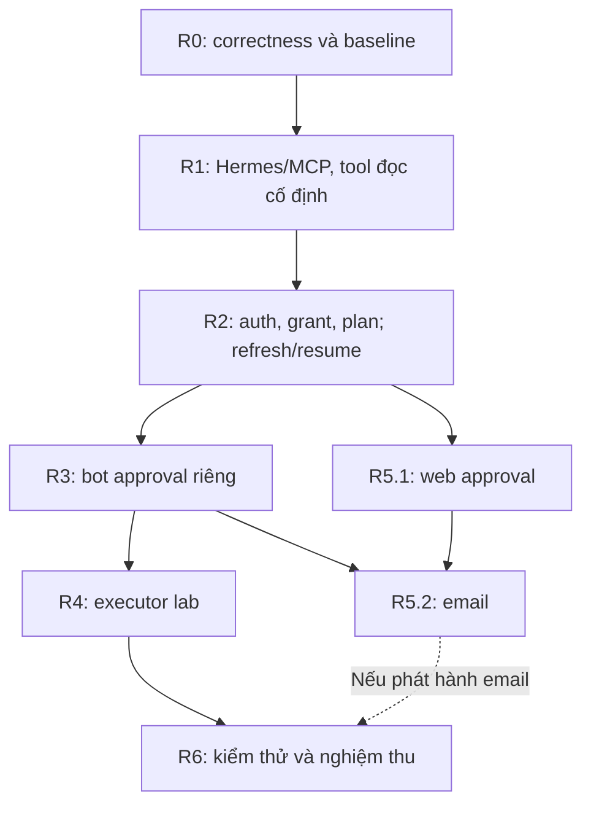

# Hướng dẫn giải quyết issue: agent điều tra và khắc phục có phê duyệt

Ngày đối chiếu: **16/11/2026, Asia/Saigon**. Mã nguồn: [`main@baa7192`](https://github.com/haizzdungnay/local-ai-siem-analyzer/commit/baa7192704a0d127b7d75aeb8ad53f4c47af0dd2). Phạm vi: [Epic #10](https://github.com/haizzdungnay/local-ai-siem-analyzer/issues/10), 17 issue triển khai R0–R6 và hai issue phối hợp/review #23, #29.

**Điều chỉnh đã chốt:** Hermes Agent điều phối qua MCP server SIEM; tool có handler trong catalog được cấp thêm theo xác nhận client. Backend giữ identity/grant/approval/executor; quyền động chỉ bật sau #18, R1 vẫn dùng tool đọc cố định. Đây là cập nhật thiết kế, chưa cài Hermes hoặc bổ sung tool runtime.

**Đây là hướng dẫn triển khai, không phải báo cáo đã hoàn thành.** Khi đối chiếu, các issue trên đều đang mở; runtime approval/executor chưa có. Tên module, trường dữ liệu và test mới dưới đây là đề xuất cho người triển khai. Đọc lại HEAD và issue trước khi bắt đầu vì người khác có thể đã sửa một phần.

[Roadmap thiết kế](approval-remediation-agent-roadmap.md) quy định phạm vi và quyền; tài liệu này chỉ cách chia việc, sửa ở đâu, kiểm chứng thế nào và khi nào được đóng issue. Tiêu chí nghiệm thu trong issue vẫn áp dụng. Nếu cần đổi phạm vi, ghi quyết định và đồng bộ issue/roadmap trước khi gọi phần bị cắt là hoàn thành.

## 1. Cách dùng và thứ tự triển khai

### Các mốc có thể bàn giao

| Mốc | Kết quả bàn giao | Điều kiện chuyển tiếp |
|---|---|---|
| R0 | Nguồn dữ liệu trung thực, nhánh playbook không giả bằng chứng, baseline có version | #11, #12, #13 được nghiệm thu; protocol #27 đã chuẩn bị |
| R1 | Hermes gọi tool đọc qua MCP, có receipt và tích hợp dashboard | #14, #15; fixed allowlist, model tool-call và field lab pilot |
| R2 | Auth, grant tool, pause/resume và duyệt plan với fake executor | #16, #17, #18; client host xác nhận, không có quyền ghi thật |
| R3 | Client Telegram duyệt grant/plan bằng bot approval riêng | #19, #20; integration bot và Hermes được phân biệt với mock |
| R4 | Một action block IP tạm trên một victim Linux lab | #21, #22; chứng minh cả tác động và tự gỡ |
| R5 | Email dẫn đến web approval có xác thực | #24, #25; nghiệm thu riêng, không chặn bản Telegram-only |
| R6 | Bộ kiểm thử xuyên suốt, đo lường thật và runbook | #26, #27, #28; reviewer độc lập replay được |

### Hàng đợi công việc đề xuất

| Đợt | Issue | Thứ tự và phần có thể chuẩn bị đồng thời | Đầu ra phải có |
|---|---|---|---|
| 0 | [#23](https://github.com/haizzdungnay/local-ai-siem-analyzer/issues/23), [#29](https://github.com/haizzdungnay/local-ai-siem-analyzer/issues/29) | Chốt điểm giao schema/người tích hợp; dựng protocol #27 sớm | Biên bản quyết định, danh sách file chung, bộ development tách held-out |
| 1 | [#11](#issue-11), [#12](#issue-12), [#13](#issue-13) | Có thể phát triển độc lập; ưu tiên chặn partial và nhánh chưa xác minh trước | Regression lỗi hiện tại, contract dữ liệu, baseline mới |
| 2 | [#14](#issue-14) | Sau #11 + #12 + #13; không chờ #18 | Hermes/MCP chỉ đọc, catalog cố định, receipt/budget/scope |
| 3 | [#15](#issue-15) | Sau #14; nhận phần window/playbook đã thống nhất ở #23 | Dashboard dùng đúng evidence/playbook, có provenance |
| 4 | [#16](#issue-16), [#17](#issue-17) | Cùng sau #15; auth và plan có thể phát triển độc lập khi đã chốt contract | Identity/role/session; schema/hash/policy |
| 5 | [#18](#issue-18) | Sau #16 + #17; dùng adapter #14 | Grant/approval transaction, client host, refresh/resume và fake executor |
| 6 | [#19](#issue-19) → [#20](#issue-20) | Bot approval riêng; #24 có thể bắt đầu sau #18 | Pairing, poller và callback cấp tool/duyệt plan |
| 7 | [#21](#issue-21) → [#22](#issue-22) | Worker fake trước, adapter/lab sau | Journal/reconcile; block và cleanup đã kiểm chứng |
| Nhánh email | [#24](#issue-24) → [#25](#issue-25) | #24 cần #18; #25 cần cả #24 và #20 | Web/email dùng chung approval core |
| 8 | [#26](#issue-26), [#27](#issue-27) | Viết test/protocol từ sớm; đóng #26 sau #22, kết quả C của #27 cũng chờ #22 | Fault injection, regression lab, study thật |
| 9 | [#28](#issue-28) → [#10](https://github.com/haizzdungnay/local-ai-siem-analyzer/issues/10) | Sau #26 + #27; bản có email phải đạt thêm #24 + #25 | Runbook, release evidence và đóng epic |

Với một người làm chính, đi theo đợt 1–9; tạm để R5 sau MVP Telegram nếu thiếu thời gian. Không cần đợi Hybrid Gateway hoặc QLoRA. “Chuẩn bị đồng thời” không có nghĩa được bỏ dependency nghiệm thu. Ví dụ có thể viết fake adapter sớm, nhưng chưa được gọi R4 hoàn thành.



## 2. Bản đồ mã nguồn và hợp đồng cần chốt

### Điểm vào hiện có

| File/nhóm hiện có | Nơi cần đọc hoặc mở rộng | Issue |
|---|---|---|
| `ai_module/reader.py` | `_parse_search_response`, `_parse_window_aggregations`, `fetch_alerts_range`, `fetch_alerts_window` | #11, #14 |
| `ai_module/playbooks.py`, `ai_module/llm.py` | `combine_answers`, `select_branch`, `_parse_playbook_payload`, `analyze_alert`, `analyze_window` | #12, #15, #29 |
| `ai_module/rag_data/playbooks.yaml`, `docs/playbook_template.yaml` | Signals, điều kiện nhánh, query template; giữ schema/test đồng bộ | #12, #15, #17, #23 |
| `ai_module/rag.py` | `RuleRAG._load_corpus`, manifest/index generation, query/context | #13 |
| `ai_module/analysis_service.py` | `analyze_one`, `analyze_aggregate`, coverage và RAG provenance | #11, #14, #15 |
| `ai_module/dashboard_store.py`, `dashboard_worker.py`, `dashboard_reports.py` | SQLite v9, lifecycle job/delivery, partial, export, backup/restore/retention | #11, #18, #21, #28 |
| `ai_module/dashboard.py`, `blueprints/`, `web/` | App factory, endpoint policy, UI, operator auth và trang duyệt | #15, #16, #24 |
| `ai_module/telegram_notifier.py`, `gmail_notifier.py` | Outbound hiện tại; tái dùng redaction/transport, không gộp quyền vào notifier | #19, #20, #25 |
| `tests/`, `eval/`, `.github/workflows/python-tests.yml` | Regression, protocol, provenance và CI matrix | Tất cả |

**Module mới đề xuất:** `siem_mcp.py`, `investigation_service.py`, `remediation_planner.py`, `approval_service.py`, `remediation_store.py`, `remediation_worker.py`, `telegram_approval.py`, `remediation_actions/`, `blueprints/approvals.py`, đặt dưới `ai_module/`. Hermes chạy bằng profile/version đã pin; chỉ thêm adapter MCP, không viết lại vòng điều phối agent trong `llm.py`. Catalog nằm trong registry code; grant dùng service/store đã có kế hoạch, chưa cần plugin manager hoặc DB riêng. Có thể tách auth sau #16. Adapter kênh chỉ xác minh input và gọi cùng service.

### Hermes/MCP và quyền tool theo yêu cầu

Contract quyền chi tiết ở [roadmap](approval-remediation-agent-roadmap.md#hermes-mcp-và-cấp-quyền-tool). Chia triển khai để không tạo dependency vòng:

- **#14/R1:** Hermes profile giới hạn, MCP stdio local, context/service identity chỉ đọc do host cấu hình, catalog/schema/version và adapter vào reader/playbook. Giữ luồng JSON phân tích cũ; model phải sinh tool call hợp lệ theo giao thức Hermes/endpoint, không suy ra lệnh từ văn bản tự do. Không expose credential hay cổng MCP công khai, terminal/file write/code execution tổng quát hoặc công cụ tự cài plugin/server.
- **#16–#18/R2:** gắn context operator/request tin cậy vào kết nối; bật `list_available_tools`, `request_tool_access`, `propose_remediation` (chỉ tạo draft), `get_request_status` và client host đã xác thực để cấp/từ chối/thu hồi. Trước đó tool động disabled. #24 hoàn thiện web/email/mobile sau; panel cơ bản R2 đủ kiểm grant bằng fake executor.
- **#19–#20/R3:** đưa cùng quyết định lên bot approval SIEM riêng. Hermes gateway dùng bot/token khác nếu bật; cùng bot không có hai poller. Model không được gọi endpoint cấp grant/confirm hoặc nhận credential của operator.
- **#21–#22/R4:** action tool gọi cùng service/queue; final confirm đã tạo execution thì trả lại ID đó, không tạo lần dispatch khác. Worker mới gọi adapter có quyền ghi thật sau toàn bộ gate.

| Record đề xuất | Nội dung tối thiểu |
|---|---|
| Catalog entry | Tool ID/version, schema/handler/policy digest, loại đọc/ghi, handler đã review và scope được phép xin |
| Access request | ID/idempotency key, operator/request/run binding từ context backend, tool/version, scope/tham số giới hạn, lý do/evidence refs, expiry và state |
| Grant | ID, access request, actor/request binding, tool/version/digests, scope, max uses/deadline, plan hash nếu ghi, revision và state |
| Resume event | Event ID/revision, request/grant refs và trạng thái đã commit; không chứa bearer secret, command hoặc credential |

Access request: `pending → granted|denied|expired|cancelled`; grant: `active → exhausted|revoked|expired`. Task chờ ở `awaiting_tool_approval`; `needs_tool_development` khi yêu cầu khả năng chưa có handler, ngoài policy thì deny. Cấp quyền không tự cài mã; handler mới cần PR/test/đăng ký catalog trước khi xin quyền. Repeated denied request cùng tool/scope phải trả quyết định hiện có, không spam card hoặc lặp vô hạn.

Backend kiểm context/role/grant/version/scope/deadline/lượt dùng tại mọi call và trước worker dispatch; không tin `operator_id` model tự khai hoặc schema đang hiện trong Hermes. `notifications/tools/list_changed`/reload chỉ cập nhật khả năng nhìn thấy, không cấp quyền. Filter theo caller/request; registry Hermes toàn process không được trở thành grant cho chat khác. Claim budget/use bằng CAS với invocation ID; grant/retry/refresh không reset request budget/deadline. Worker tiêu thụ write usage khi ghi dispatch intent; facade/status không trừ lượt hoặc tạo execution khác. Số lượt điều phối/control cũng có trần; chờ bằng event/status có backoff, không poll hoặc xin quyền vô hạn. Grant ID nằm ngoài canonical plan và trỏ đến plan hash, tránh hash tự tham chiếu.

MVP một operator/một request chủ động trong profile Hermes riêng. Host launcher gắn context bất biến cho kết nối MCP stdio; chat/tool arguments không đổi binding, yêu cầu concurrent khác bị từ chối. Mở nhiều request chỉ sau test isolation/transport xác thực từng request. Read grant nằm trong query budget/hạn request; write grant cho một execution và không vượt execution deadline. Không dùng TTL firewall làm hạn grant.

Card client cần tool/chức năng, victim và IP nguồn hoặc miền truy vấn, lý do/evidence, số lần, expiry, tác động và rollback. Mutation cần auth/role/CSRF hoặc Telegram binding đã xác minh. Quyền đọc chỉ được cấp trong scope request; quyền ghi gắn plan hash và được ghi cùng review/confirm kế hoạch, không có endpoint grant-only cho phép dispatch. Xin tool ghi chưa có plan trả `needs_plan`; dùng `propose_remediation` gọi planner tạo draft trước khi xác nhận. Revoke/expiry dừng call mới, giữ cleanup đã được duyệt. Tool lỗi/uncertain không bị model thử lại bằng shell hay handler khác.

Lưu grant và sự kiện resume qua transaction/outbox. Chỉ sau commit mới refresh schema/resume; event trùng/trễ phải idempotent và kiểm lại state hiện tại. Nếu Hermes đã mất phiên, UI giữ kết quả/pending để operator tiếp tục phiên được xác thực. Grant hết hạn, đổi handler hoặc model restart không tự tạo quyền lại. Pin và kiểm integration bản Hermes với cơ chế refresh/resume thực sự dùng; chưa test thì không báo hot reload đã hoạt động.

### Evidence và signals

Một receipt cần có `evidence_id`, tool ID/version, scope agent/thời gian, tham số chuẩn hóa hoặc digest truy vấn, identity nguồn (`_index`, `_id` nếu có), hash kết quả, thời điểm thu thập, coverage, partial reasons và trạng thái `complete|partial|failed|not_run`. Lưu nội dung nhạy cảm theo chính sách hiện có; report/outbound chỉ dùng bản giảm dữ liệu. Hash chỉ chứng minh snapshot không bị đổi, không chứng minh log nói thật.

Phân biệt ba nguồn: field trong alert, kết quả query có receipt, và suy luận LLM. Đề xuất mở rộng signal bằng `source_kind`, `evidence_refs`, `verification_status`; giữ `answer`, `model_answer`, `rule_answer` để so sánh. Không cho LLM tự ghi `verified=true`. Thiếu dữ liệu, thiếu thời gian lưu trữ hoặc query chưa chạy là `unknown/not_run`, không đổi thành `no`.

Các query dùng cho UI hiện là DQL đã render. **DQL hiển thị không phải OpenSearch JSON Query DSL**: không đưa nguyên chuỗi đó vào `_search` và giả định tương đương. Ở #14, ánh xạ query ID đã review sang builder DSL có kiểu dữ liệu; tái dùng quy ước placeholder/identity, không dùng LLM để dịch query khi chạy. Test đối chiếu nghĩa giữa bản hiển thị và builder.

### Plan, quyền và vòng đời

| Contract đề xuất | Quyết định cần giữ xuyên suốt |
|---|---|
| Scope | Một target từ inventory, tối đa 3 bước ghi; MVP chỉ `block_source_ip_temporary` |
| Budget đọc | Mặc định tối đa 6 query/request, 30 giây/query; thêm deadline toàn request và giới hạn kích thước kết quả |
| Tool grant | Gắn actor/request/tool version/digests/scope/max uses và expiry; write grant gắn plan hash, không cấp quyền shell chung |
| Plan bất biến | Version/hash bao gồm action, target identity, tham số, evidence refs, policy/script digest, preconditions, verifier, retry, rollback và thời hạn có ý nghĩa |
| Chuẩn hóa | Dùng một serializer server-side, định dạng UTC và IP nhất quán, số nguyên cho TTL, thứ tự step có ý nghĩa; từ chối NaN, unknown field và boolean giả số nguyên |
| Review/confirm | Hai thao tác khác nhau; cùng operator đã xác thực, cùng version/hash. Lượt review chưa enqueue executor |
| Hạn dùng | Plan/challenge 10 phút theo deadline tuyệt đối của bản được duyệt; challenge không vượt hạn plan. Confirmation hợp lệ tạo execution deadline 15 phút; retry không gia hạn |
| Block | TTL mặc định 300 giây, tối đa 600; tính từ lúc tác động được tạo, không reset vì retry/callback/restart |
| Preflight | Trước mỗi tác động; receipt kiểm tra điều kiện không quá 60 giây. Điều kiện thay đổi có ý nghĩa thì dừng và xin duyệt bản mới |
| Cleanup | Quyền gỡ đúng resource do execution tạo tồn tại sau expiry/revoke/stop; không mở rộng quyền sửa tài nguyên khác |

**Điểm cần thiết kế rõ ở #17/#21:** evidence đã dùng để duyệt là snapshot bất biến. Receipt preflight mới chỉ xác nhận lại các điều kiện đã ghi, được lưu trong execution journal; không âm thầm sửa snapshot trong plan. Nếu kết quả mới đổi target, lý do hành động, phạm vi hoặc điều kiện quan trọng, phải supersede và duyệt lại. Nếu policy yêu cầu thay evidence trong plan, cũng phải tạo version mới.

**Transaction xác nhận cuối đề xuất:** xác thực actor → bắt đầu transaction ghi → đọc và kiểm plan/challenge/binding/role/deadline/tool versions → CAS trạng thái → consume challenge → ghi hoặc kiểm grant đúng plan, approval, audit và execution/outbox duy nhất → commit. Không gọi Hermes/MCP discovery/Telegram/Wazuh trong transaction. Worker chỉ nhận record đã commit. Unique constraint gắn approval với execution; action tool gọi lại sau resume chỉ trả execution đó. Mỗi step có idempotency key; unique row không bảo đảm tác động bên ngoài chỉ chạy một lần.

## 3. Hướng xử lý từng issue

### Issue 11

**[#11 — R0.1: Indexer partial và timeline](https://github.com/haizzdungnay/local-ai-siem-analyzer/issues/11)**. Không có dependency. Điểm sửa: `reader.py`, rồi nơi truyền kết quả trong `analysis_service.py`, worker/store/report nếu cần.

1. Thêm fixture tái hiện HTTP 200 với `timed_out=true`, `_shards.failed>0`, metadata không hợp lệ và `hits.total.relation=gte` trên đường cần tổng chính xác. Test cả aggregate lẫn detail, không chỉ status HTTP.
2. Tạo validator dùng chung cho tính hoàn chỉnh của search response. **Đề xuất vòng đầu:** đường dùng làm evidence hành động phải fail closed bằng lỗi có loại/lý do; đường báo cáo có thể giữ partial nếu truyền được lý do đến UI/export. Không để `{hits: []}` sau lỗi thành “không có sự cố”.
3. Giữ riêng ba khái niệm: Indexer trả thiếu, chọn mẫu do budget, và không đủ lịch sử lưu trữ. Chúng có ảnh hưởng khác nhau; query trả đủ không chứng minh đã có đủ 30 ngày lịch sử.
4. Với bucket `[b0,b1)`, giữ khi `b0 < end` và `b1 > start`; nhãn hiển thị là `[max(b0,start), min(b1,end))`. Count lấy nguyên từ aggregation đã lọc đúng cửa sổ, không nhân tỷ lệ phút. Ví dụ query 10:03–10:08 phải giữ bucket 10:00–10:05; không lấy count của query rộng hơn rồi tự suy ra phần 10:03–10:05.
5. Kiểm tra đường full-detail dùng hai request: total thay đổi hoặc một request partial không được tạo báo cáo đầy đủ. Trường hợp không chứng minh snapshot đồng nhất phải ghi hạn chế hoặc từ chối theo contract.

**Kiểm thử:** mở rộng `tests/test_dashboard_core.py`, `tests/test_audit_edge_cases.py`, `tests/test_dashboard_store_worker.py`. Có biên đầu/cuối, cửa sổ đúng biên, lệch biên, rỗng, nhiều bucket; count không bị mất/lặp. Kiểm lan truyền lỗi/partial tới stored job và JSON report.

**Đóng issue khi:** regression thất bại trước sửa, pass sau sửa; không có empty-success giả; UI/report phản ánh coverage. Bằng chứng mock đủ cho parser, nhưng phải ghi rõ chưa xác minh response lab nếu chưa chạy.

### Issue 12

**[#12 — R0.2: Nhánh benign và severity](https://github.com/haizzdungnay/local-ai-siem-analyzer/issues/12)**. Không có dependency; phối hợp #23/#29 trước khi sửa chung `llm.py`, `playbooks.py`, YAML/template.

1. Tái hiện rule 5760 với model chọn một branch ID benign hợp lệ nhưng chưa có kết quả lịch sử. Viết assertion riêng cho `branch_valid`, nguồn severity, nội dung bước “đóng” và trạng thái bằng chứng.
2. Tách **ID hợp lệ** khỏi **điều kiện đã chứng minh**. Đề xuất hotfix: các playbook v5 chưa có evaluator được đưa về `B_unknown` và chỉ xuất bước điều tra; lời model mô tả query không phải receipt. Có thể merge lớp chặn này trước khi hoàn tất 25 playbook, nhưng không tự đánh dấu toàn bộ nội dung đã review.
3. Với signals v6.1, giữ nguồn model/regex và kết quả kết hợp. Regex/model nói yes có thể nâng mức cần điều tra; riêng model yes không biến thành bằng chứng đã xác minh để cho phép ghi. Nhánh query-only phải tiếp tục chờ evaluator dựa trên receipt. Kiểm cả precedence khi nhiều `select_if` cùng khớp.
4. Đề xuất cho `B_unknown`: thể hiện “chưa xác định” và `needs_evidence`; không gắn câu đóng sự cố. Giữ sàn rule đã có, không cho nhánh chưa xác minh hạ mức đang cần điều tra. Nếu cần giữ severity để sắp hàng, lưu rõ `model_severity`, `effective_severity`, `severity_source`; chỉ giảm nhờ bằng chứng đã kiểm hoặc human review theo policy. Không đặt sàn toàn bộ rule bằng mức nhỏ nhất của các nhánh: chưa có cơ sở hiệu chỉnh cho cách đó.
5. Mở rộng signals theo batch nhỏ của bên playbook; playbook không cần signals vẫn có thể dùng `B_unknown`/manual verification. Không cần ép 28/28 có regex mới gọi là an toàn. Đồng bộ `docs/playbook_template.yaml` cùng mỗi thay đổi schema.

**Kiểm thử:** `tests/test_playbook_trusted.py`, `tests/test_playbooks_yaml.py`, `tests/test_prompt_injection.py`, test severity hiện có. Bao gồm benign/attack, field thiếu, model yes sai, model no sai, regex không match, query partial, log chứa chỉ thị và hai nhánh cùng khớp. Kiểm qua `analyze_alert`, không chỉ helper parser, vì severity floor chạy sau parser.

**Đóng issue khi:** không còn đường tự đóng/hạ severity chỉ nhờ enum hoặc lời model; các pilot được review với ca âm tính; batch chưa review vẫn bị chặn an toàn và giới hạn được ghi rõ. Smoke 3 ca không thay held-out.

### Issue 13

**[#13 — R0.3: RAG và baseline](https://github.com/haizzdungnay/local-ai-siem-analyzer/issues/13)**. Không có dependency cứng để bắt đầu; phần freeze cuối phải thống nhất với #12/#23 và protocol #27.

1. Kiểm tra schema thực của `rag_data/wazuh_rules.json` và `mitre_techniques.json`. Lập bảng field → mục đích → có index không; ưu tiên mô tả, mapping rule/MITRE, detection và mitigation hữu ích. `_load_corpus` hiện chỉ đưa rule description và technique name/description vào document.
2. Viết formatter có budget, chunk theo nội dung và ID ổn định; provenance ghi source ID, field/section, corpus version. Không đưa toàn bộ record lớn vào mọi prompt; nội dung truy xuất vẫn là dữ liệu tham khảo, không được cấp quyền tool.
3. Kết hợp exact lookup `rule.id`/`mitre.id` với semantic fallback; deduplicate và giới hạn context. Đề xuất giữ exact match hợp lệ kể cả semantic score thấp, nhưng gắn nguồn rõ và không tự coi nó phù hợp mọi tình huống.
4. Đổi manifest/index schema khi đổi cách dựng document; dùng cơ chế generation swap hiện có, rebuild index cũ đúng lúc. Kiểm old generation vẫn phục vụ được nếu rebuild thất bại, tránh xóa index tốt trước khi bản mới sẵn sàng.
5. Dùng development cases để chọn field/chunk/threshold; đo case 5712, không có rule, rule ID không tồn tại, có nhiều MITRE. Ghi rõ `disabled`, `no_match`, `filtered_out`, `error`, không gom thành “RAG rỗng”.
6. Freeze code/model digest/prompt/extractor/KB/playbook/policy/config sau khi chốt development; khóa protocol và held-out trước lượt test chính thức. Có thể khóa định nghĩa split sớm, nhưng không mở nhãn held-out để hoàn thiện signals rồi gọi đó là test độc lập. Lưu baseline mới riêng, không ghi đè kết quả lịch sử.

**Kiểm thử:** `tests/test_ai_pipeline.py`, `tests/test_rag_benchmark.py`, `tests/test_build_kb.py`, test window RAG trong `tests/test_dashboard_core.py`. Mock kiểm field đi vào corpus/context; lượt embedding/retrieval thật phải ghi model/corpus digest. Đọc cách ghi output của `eval/rag_retrieval_eval.py` trước khi chạy để không ghi đè artifact cũ.

**Đóng issue khi:** formatter/provenance/index invalidation có regression, có số liệu retrieval đúng version và manifest baseline/protocol. Chưa có embedding thật thì chưa tuyên bố retrieval đã tốt hơn.

### Issue 14

**[#14 — R1.1: Tool điều tra chỉ đọc](https://github.com/haizzdungnay/local-ai-siem-analyzer/issues/14)**. Cần #11 + #12 + #13; không phụ thuộc #18. Module mới đề xuất: `investigation_service.py`, `siem_mcp.py`; Hermes profile chỉ có tool đọc do host cấu hình.

1. Bắt đầu bằng một workflow SSH pilot, ví dụ query thất bại cùng nguồn, đăng nhập thành công liên quan, và lịch sử cùng agent/user trong scope. Mỗi tool có ID/version, input schema, field allowlist, builder DSL, timeout và parser; đối chiếu rule/field thực trước khi dùng.
2. Request giữ immutable scope agent identity và time range; mọi query là tập con của quyền đó. Việc tra 24 giờ/30 ngày phải nằm trong scope đã cho phép; nếu không, trả `needs_evidence`, không tự mở rộng. Không nhận URL/index, raw DQL/DSL hoặc tên tool tùy ý từ LLM.
3. Áp budget 6 query, 30 giây/query và trần kết quả; retry cũng tiêu thụ ngân sách. Deadline toàn request/cancel phải dừng query tiếp theo. Dùng Hermes làm vòng điều phối bị giới hạn bởi service; không viết vòng agent tổng quát thứ hai. MCP không nhận endpoint/query string tùy ý hoặc tự suy lệnh từ model text.
4. Lưu receipt trước khi kết quả được dùng để chọn nhánh. Query rỗng có coverage đủ khác với nguồn chỉ giữ 7 ngày trong yêu cầu 30 ngày. Kết quả không hoàn chỉnh không được chứng minh điều kiện “không có sự kiện”.
5. Query-derived signal được code tính từ receipt theo evaluator đã review. LLM chỉ tóm tắt và đề xuất hướng hỏi tiếp. Credential công cụ này chỉ đọc Indexer `:9200`; không truyền credential Manager/executor vào service hoặc prompt.
6. Đăng ký schema/handler/digest trong catalog; chỉ expose subset đọc cố định qua MCP stdio. Pin Hermes/profile và kiểm đường Ollama tool call với model baseline hiện tại; sai protocol/JSON/schema thì trả lỗi có loại hoặc abstain. Thử bằng fixture trước, sau đó truy vấn pilot đã được phép; giữ proof end-to-end riêng với test helper. Grant động chỉ kích hoạt ở #18.

**Kiểm thử:** đề xuất `tests/test_investigation_service.py`, `tests/test_siem_mcp.py`: tool lạ, target khác, thời gian ngoài scope, ký tự chèn query, budget/retry/cancel, timeout, source partial, ID giả và replay receipt thuộc request khác. Thêm fixture đúng schema; integration Hermes → MCP → handler → tool result kiểm lựa chọn tool, tham số, receipt và dừng đúng budget, không chỉ đọc chuỗi model trả.

**Đóng issue khi:** truy được từng kết luận về receipt đúng scope; ca thiếu bằng chứng abstain; không có đường ghi hoặc shell. Có integration đúng Hermes/model/profile version và lab smoke chỉ đọc ghi riêng; không dùng mock để khẳng định tool-call/transport thật đã chạy.

### Issue 15

**[#15 — R1.2: Window/dashboard dùng playbook](https://github.com/haizzdungnay/local-ai-siem-analyzer/issues/15)**. Cần #14. Điểm sửa: `analysis_service.py`, `llm.py`, `playbooks.py`, UI/report; chốt một người tích hợp theo #23.

1. Định nghĩa group key có rule, agent và phạm vi thời gian; source/user khi cần phải có nguồn. Không lấy một sample log đại diện làm bằng chứng cho mọi alert trong bucket.
2. Chọn các nhóm ưu tiên trong budget đã cấu hình; exact lookup playbook cho từng nhóm. Ghi số nhóm/alert được bao phủ và bị cắt, không nạp cả 28 playbook vào mỗi prompt.
3. Nối vào `analyze_aggregate` → `analyze_window` bằng contract có cấu trúc. Nếu bên playbook đã merge phần dựng bước, dùng hàm đó và thêm evidence adapter; không viết một pipeline cạnh tranh.
   Request điều tra theo Hermes dùng cùng service/receipt; phân tích JSON cũ vẫn hoạt động. UI hiển thị task đang chạy/chờ tool/kết thúc theo state backend, không dựng quyền từ lời model.
4. Hiển thị “đề xuất query”, “query đã chạy”, “nhánh chưa xác minh” riêng. Trên lần phân tích thường chỉ dựng gợi ý; query bổ sung chạy qua request điều tra rõ scope/budget. Giữ hành vi khi playbook/remediation disabled.
5. Thêm VI/EN cho nội dung do code dựng, không chỉ nhãn nút; bản dịch thiếu phải được báo đúng. Report/export giữ provenance, không để UI hiện cảnh báo partial nhưng PDF/JSON lại báo hoàn chỉnh.

**Kiểm thử:** mở rộng `tests/test_dashboard_core.py`, `tests/test_dashboard_store_worker.py`, `tests/test_dashboard_ui.py`. Full/aggregate, nhiều rule/agent, no-match, group bị cắt, source thiếu, VI/EN và disabled. Kiểm cả call contract và output người dùng thấy.

**Đóng issue khi:** người dùng đi từ dashboard đến query/evidence/playbook thực, không chỉ CLI chạy được; truy vấn pilot được kiểm field lab và bản ghi live đã sanitize. Phần tích hợp do người khác làm phải được liên kết PR và review, không tính hai lần.

### Issue 16

**[#16 — R2.1: Operator identity và quyền duyệt](https://github.com/haizzdungnay/local-ai-siem-analyzer/issues/16)**. Cần #15. Điểm sửa: app factory/blueprints, module auth mới và cấu hình mẫu; tham chiếu [security governance](security-governance.md).

1. Đề xuất MVP một operator được bootstrap tại host, identity nội bộ ổn định; không mở tự đăng ký. Dùng thư viện xác thực/password hashing đã được duy trì nếu dùng password, không tự viết mật mã. Secret/session key nằm ngoài Git.
2. Mô hình quyền tối thiểu gồm xem, yêu cầu điều tra, review và confirm/execute; backend kiểm ở mọi transition. Quyền revoke/stop phải rõ. Worker dùng service identity/capability riêng, không giữ phiên trình duyệt của người duyệt.
3. Ưu tiên session có thể thu hồi trên server; đổi role/logout/revoke phải ảnh hưởng cả challenge và các bước chưa dispatch. Thiết lập expiry, xoay session sau đăng nhập, chống dò mật khẩu và audit không chứa password/token.
4. Thêm CSRF cho mutation từ browser và giữ Host/Origin checks như lớp bổ sung. Cookie HttpOnly, SameSite và Secure theo transport; truy cập ngoài loopback cần TLS và chính sách endpoint đầy đủ. Origin/Host hợp lệ không thay danh tính operator.
5. Chốt step-up/re-authentication theo risk policy. Nếu chưa có khả năng step-up, action đòi nó phải bị từ chối, không chuyển về hai lần bấm Telegram. Action rủi ro cao vẫn ngoài MVP.
6. Quyền request/grant/deny/revoke tool tách rõ theo role. Backend tạo binding operator/request cho transport MCP từ phiên đã xác thực; actor/run ID trong tool arguments không có giá trị cấp quyền. Grant UI ban đầu trên host thuộc #18; chưa bật từ #14. Bảo vệ cả endpoint cấu hình bot/catalog/grant đang dùng khi activation, không chỉ nút approve mới.

**Kiểm thử:** đề xuất `tests/test_operator_auth.py`, thêm test vào `tests/test_dashboard_api.py`: sai role, session hết hạn/đã revoke, CSRF, fixation, session cũ sau logout, quyền bị hạ giữa review và confirm. Disabled mode giữ tương thích ứng dụng cũ trên loopback; không vì vậy được mở từ xa khi endpoint cũ chưa được bảo vệ.

**Đóng issue khi:** API không thể review/confirm/grant chỉ nhờ biến client hoặc actor model tự khai; có bootstrap/recovery được tài liệu hóa, quyền/expiry được thực thi server-side. Không cần bật truy cập mobile để hoàn thành nền auth.

### Issue 17

**[#17 — R2.2: Plan, action registry và policy](https://github.com/haizzdungnay/local-ai-siem-analyzer/issues/17)**. Cần #15; có thể phát triển cùng #16. Module mới: `remediation_planner.py`, registry trong `remediation_actions/`.

1. Tạo schema version đầu tiên và validator strict trước khi nối LLM. LLM chỉ đề xuất action ID/tham số; backend giải target qua inventory, kiểm evidence, chuẩn hóa và bổ sung script/verifier/rollback cố định.
2. Registry MVP chỉ khai báo `block_source_ip_temporary`; mỗi action có schema tham số, capability, protected-resource checks, preconditions, retry/reconcile, expected effect và cleanup. Adapter giai đoạn này là fake/dry-run. Không có entry generic shell/SSH hoặc command string tùy ý.
3. Target identity phải có inventory revision/generation thích hợp để tránh agent ID được tái sử dụng. IP nguồn là tham số được xác minh, không phải tên endpoint để kết nối quản trị. Kiểm manager/operator/gateway/DNS và protected inventory bằng policy do server quản lý.
4. Tạo canonical bytes một lần cho plan, hash toàn bộ nội dung có quyền. Tách presentation VI/EN khỏi canonical execution payload; hiển thị phải được dựng từ payload đó. Thay target, TTL, script, policy, evidence quan trọng hoặc bước → version mới và invalidate approval cũ.
5. Nếu thêm mapping vào playbook theo #23, dùng trường tùy chọn riêng như `remediation`; giữ `branches[].actions` là hướng dẫn văn bản. Mapping chưa đủ evidence/policy chỉ tạo candidate, không tự enqueue và không biến draft playbook thành quyền ghi.
6. Return lỗi có mã lý do, ví dụ thiếu evidence/target protected/action không hỗ trợ; UI giải thích điều cần bổ sung. Không âm thầm thay action nguy hiểm bằng action khác rồi giữ hash/approval cũ.
7. Catalog gồm tool đọc đã review và action facade MVP; schema/handler/policy digest có trong plan canonical. `request_tool_access` chỉ cấp quyền tool trong catalog được policy cho phép; mô tả khả năng chưa có handler trả `needs_tool_development`, không tạo quyền chạy mã. Action tool chỉ nhận plan ID/expected hash và trỏ execution được duyệt; không nhận shell hoặc tự thay target/TTL. Grant ghi gắn một plan, không mở quyền cho các plan tương lai.

**Kiểm thử:** đề xuất `tests/test_remediation_planner.py`: round-trip canonicalization, đổi mọi field có ý nghĩa phải đổi hash, khác thứ tự key không đổi hash, thứ tự step có thay đổi hash, malformed/extra field, TTL sai kiểu/vượt trần, target ngoài inventory, model trả shell, prompt injection trong alert.

**Đóng issue khi:** có schema và ví dụ sanitized được validator kiểm; policy độc lập confidence/model/provider; mọi candidate chỉ chạy fake. Thay đổi cách render không được che bớt phạm vi mà operator cần thấy.

### Issue 18

**[#18 — R2.3: Approval core và persistence](https://github.com/haizzdungnay/local-ai-siem-analyzer/issues/18)**. Cần #16 + #17. Module mới: `approval_service.py`, `remediation_store.py`; tích hợp migration qua lifecycle SQLite hiện có.

1. Recheck `SCHEMA_VERSION` trước khi chọn số migration: baseline là v9, gateway cũng dự kiến sửa DB. Có một đầu mối migration; không tự tạo một SQLite schema version cạnh tranh. Migration cộng thêm, có test dữ liệu job/review/delivery cũ.
2. Thiết kế bảng request/plan/step/challenge/approval/execution/event/inbox/outbox/binding như roadmap. Thêm unique constraint cho `(channel, event_id)`, execution theo approval, step idempotency; foreign key và index cho pending/deadline/lease.
3. Service chỉ cho `awaiting_review → awaiting_confirmation → approved`. Review tạo challenge ngẫu nhiên một lần, lưu digest; confirm kiểm actor/hash/version/deadline và tiêu thụ trong transaction ở mục 2. Repeated confirm trả trạng thái hiện tại hoặc conflict có kiểm quyền, không tạo job mới.
4. Reject, expire, supersede, revoke vô hiệu các challenge còn lại. `GET` chỉ đọc; job nền hoặc mutation xử lý expiry, không để mở link gây transition. Clock lùi/bất thường phải chặn dispatch mới và yêu cầu xử lý, không làm token sống lâu hơn.
5. Fake executor ghi nhận invocation trong bộ nhớ/journal test. R2 không khởi tạo adapter có credential live. Tách approval state khỏi delivery state: SMTP/Telegram thành công không phải approved.
6. Backup/restore cần một recovery mode: invalidation pending challenge/session, reconcile execution chưa rõ và ownership cleanup trước khi cho ghi lại. Bản DB cũ không được hồi sinh quyền đã dùng hoặc chạy lại action. Retention giữ mọi record đang có cleanup/chưa terminal.
   Restore vô hiệu grant active cũ trước khi mở call mới; cấp lại cần request/operator hiện tại, không dựa vào schema còn trong cache. Cleanup đã được duyệt và journal vẫn phải reconcile, không xóa theo grant.
7. Thêm `tool_access_requests`, `tool_grants` và checkpoint `awaiting_tool_approval` trong cùng lifecycle; access request có idempotency key và deadline. Duyệt grant đọc bằng panel host có auth/CSRF/revision; grant ghi chỉ tạo hoặc kiểm tại confirm plan cùng transaction enqueue. Action tool gọi sau confirm trả execution đã có, không enqueue lần hai. Thu hồi grant được worker recheck trước dispatch, cleanup vẫn giữ quyền riêng.
8. Mở grant động trong Hermes/MCP sau auth: ghi decision + audit + resume outbox rồi commit; refresh/list-changed trước khi resume đúng request. Lưu grant usage nguyên tử; denied/exhausted/expired, event trùng, phiên Hermes mất hoặc restore DB không được cấp lại/quên budget. Test cross-request và transport identity; không coi tool list/cache toàn Hermes là authorization.

**Kiểm thử:** đề xuất `tests/test_approval_service.py`, `tests/test_remediation_store.py`, mở rộng `tests/test_siem_mcp.py`; dùng SQLite file tạm và hai connection/worker để tạo race thật. Thử crash trước commit, DB busy, duplicate/out-of-order, role/plan/tool version đổi, deadline đúng biên, restore snapshot cũ; deny/revoke với schema cache cũ, grant usage race và đồng thời confirm/tool-call không enqueue hai lần. Integration Hermes refresh/resume phải được ghi riêng. Khẳng định cả số execution row và số fake dispatch.

**Đóng issue khi:** mọi ca trước confirm hoặc sau deny/expiry/revoke có **0 dispatch**; một approval hợp lệ chỉ có một execution record; migration/restore không mất job cũ hoặc tạo quyền mới. Client host cấp/deny/revoke quyền tool, Hermes refresh/resume đúng request và cache cũ bị chặn có integration evidence; ghi riêng giới hạn fake executor và phần Hermes thực sự đã chạy.

### Issue 19

**[#19 — R3.1: Telegram pairing và poller](https://github.com/haizzdungnay/local-ai-siem-analyzer/issues/19)**. Cần #18. Module mới: `telegram_approval.py`; notifier gửi report hiện tại vẫn độc lập với inbox quyết định.

1. Operator đăng nhập trên host để tạo pairing request ngắn hạn; Telegram gửi mã về bot; host hiển thị numeric user ID/private chat và xác nhận binding. Mã một mình không kích hoạt quyền. Chặn group và không dùng username/display name làm khóa danh tính.
2. MVP dùng bot riêng cho approval do service SIEM sở hữu; Hermes gateway nếu bật dùng bot/token khác. Kiểm webhook trước khi dùng outbound long polling; nếu đang có webhook/consumer khác, báo xung đột và dừng, không tự xóa hoặc chiếm bot. Một lease xác định consumer chủ động. Callback cấp tool/plan đi thẳng service, không qua model để nhận diện đồng ý.
3. Với một batch updates, transaction lưu inbox đã deduplicate cùng offset kế tiếp; chỉ dùng offset cao hơn ở lần poll sau khi đã commit. Worker xử lý inbox có trạng thái/retry; poller crash giữa các bước phải replay an toàn, không mất quyết định.
4. Callback data là opaque handle ngắn; giữ trong giới hạn Bot API, tra plan/message/actor/deadline ở server. Provider event ID dùng để deduplicate; không tin callback data là quyền đã xác thực.
5. Thêm backoff/rate limit, metrics poll lag/inbox age và revoke binding. Audit chỉ lưu identity cần thiết theo chính sách; token bot và raw callback/challenge không xuất hiện trong log công khai.

**Kiểm thử:** đề xuất `tests/test_telegram_approval.py`: wrong user/chat, group, pairing hết hạn/lặp/forward, hai poller, crash sau inbox commit trước xử lý, duplicate và out-of-order. Không giả định update ID liên tục. Fake Bot API cho unit test; integration cần bot test được operator cấu hình riêng.

**Đóng issue khi:** pairing/revoke và poller restart chứng minh được; gửi report cũ không bị phá. Không cần mở inbound port vào dashboard.

### Issue 20

**[#20 — R3.2: Nút duyệt Telegram](https://github.com/haizzdungnay/local-ai-siem-analyzer/issues/20)**. Cần #19. Dùng chung `approval_service`, không đưa lệnh executor vào callback handler.

1. Dựng card từ plan canonical: mã/version, alias đích, IP nguồn đã giảm dữ liệu phù hợp, hành động/TTL, căn cứ, tác động lên dịch vụ hợp lệ, rollback và hạn duyệt. Log untrusted phải escape và rút gọn, không chép nguyên username có thể chứa mật khẩu.
2. Bước một có Xem/Duyệt/Từ chối. Duyệt gọi service review; card thứ hai nhắc lại phạm vi và có Xác nhận thực thi/Quay lại/Hủy. Không để nút xác nhận có từ trước lượt review hợp lệ.
3. Ở cả hai lượt kiểm `from.id`, binding private chat, message, handle, plan version/hash, role và expiry. Handle của lượt một không dùng cho lượt hai. Quay lại/hủy phải vô hiệu challenge cũ theo state machine.
4. Acknowledge callback và cập nhật message dựa trên kết quả đã commit. Chỉnh message thất bại không rollback approval và không làm nút cũ có hiệu lực. Trường hợp retry phải hiển thị trạng thái hiện tại một cách idempotent.
5. Dùng fake executor để walkthrough đủ flow. Policy cần step-up thì chuyển tới web đã có cơ chế đó; nếu chưa có #24 thì hiển thị không hỗ trợ, không giảm yêu cầu. MVP block vẫn phải qua policy của #17.
6. Card xin tool thể hiện tool/version, scope/usage/expiry và ảnh hưởng; quyền đọc dùng grant decision, quyền ghi dùng cùng review/confirm plan. Phân biệt callback purpose, access-request ID và plan hash; bot chat Hermes hoặc text “đồng ý” không thay numeric identity/binding. Sau commit mới thông báo Hermes resume; lỗi gửi/refresh không tự cấp lại.

**Kiểm thử:** mở rộng test Telegram với confirm trực tiếp, message cũ, superseded plan, callback trùng, mạng mất sau commit, request reject cạnh tranh confirm và binding bị revoke. Thử một lượt Telegram, lượt kia qua service web với cùng identity: vẫn cùng state và chỉ một execution.

**Đóng issue khi:** mock walkthrough và integration bot test cho cả grant/plan đều có evidence; lần bấm review plan chưa enqueue, confirm đúng scope mới enqueue một lần. Hermes resume sau quyết định đã commit, deny/revoke không cấp quyền mới. Không có báo cáo “đã block” khi chỉ fake dispatch.

### Issue 21

**[#21 — R4.1: Worker, journal và reconcile](https://github.com/haizzdungnay/local-ai-siem-analyzer/issues/21)**. Cần #20. Module mới: `remediation_worker.py`; chạy với fake adapter trước khi làm #22.

1. Định nghĩa adapter contract `preflight`, `dispatch`, `observe/reconcile`, `verify`, `cleanup` và kết quả có loại: chưa gửi, đã nhận, tác động xác minh, thất bại xác định, hoặc uncertain. Lỗi mạng sau khi gửi không đồng nghĩa chưa chạy.
2. Worker claim bằng transaction/lease, khóa theo target và resource. Kiểm lại enabled mode, approval/hash, actor role/binding, grant/tool/handler version còn hiệu lực, deadline, target generation, policy/script version và evidence freshness trước mỗi lần bắt đầu tác động. Action facade MCP chỉ trả execution ID/status; không mở đường dispatch trực tiếp thứ hai từ Hermes.
3. Ghi durable dispatch intent rồi gọi adapter ngoài DB transaction; sau response ghi receipt. Crash trong khoảng này phải chuyển uncertain và reconcile. Chỉ retry khi chứng minh chưa có tác động hoặc adapter bảo đảm idempotency cho cùng operation key trong policy đã duyệt.
4. Lease hết hạn không đủ chứng minh worker cũ đã chết. Dùng fencing/generation token nếu endpoint hỗ trợ; nếu không, không chuyển quyền dispatch mù sang worker khác cho cùng resource. Reconcile hoặc chờ xử lý thủ công trước khi tạo tác động tiếp.
5. Stop/revoke được tuần tự hóa với việc bắt đầu dispatch; thắng trước dispatch thì chặn, sau dispatch thì ghi in-flight và xử lý theo verifier/cleanup. Không hứa dừng tức thì một request đã rời process. Phương án mới hoặc state drift → pause và plan mới, không nhờ LLM tự tìm lệnh khác.
6. Cleanup chạy bằng service/timer bền vững độc lập dashboard/LLM, giữ ownership/TTL đã duyệt. Quyền cleanup không phụ thuộc session operator còn sống. Queue restart phải giữ hạn gốc, không gia hạn block.

**Kiểm thử:** đề xuất `tests/test_remediation_worker.py`: hai worker, stale lease owner, crash trước/sau send, timeout sau side effect, DB lỗi khi ghi receipt, stop đúng điểm race, hết hạn giữa step, evidence mới nhưng mâu thuẫn plan. Fake adapter có external-state store riêng để test không chỉ nhìn DB.

**Đóng issue khi:** không có blind retry gây duplicate effect; trạng thái uncertain trung thực; cleanup không bị kill switch vô hiệu. Phần nền có thể nghiệm thu bằng fake adapter; khả năng chịu lỗi của endpoint thật thuộc #22/#26.

### Issue 22

**[#22 — R4.2: Block IP lab tạm thời](https://github.com/haizzdungnay/local-ai-siem-analyzer/issues/22)**. Cần #21. Module đề xuất: adapter dưới `remediation_actions/`, script endpoint version hóa và runbook lab.

1. Ghi ma trận tương thích thực tế: phiên bản Wazuh manager/agent, OS/firewall victim, cách dispatch đúng một agent, quyền API, giao thức script stateful và cách kiểm chứng. Nguồn alert vẫn là Indexer `:9200`; Manager `:55000` chỉ là đường điều khiển. Chưa chứng minh adapter trên phiên bản lab thì chưa enable.
2. Script chỉ nhận input đã định kiểu cho action này, kiểm lại IPv4/TTL/ownership và script digest. Không cho LLM chọn executable. Dùng rule/set/handle do execution sở hữu; rule đã có từ trước không được nhận làm của mình hoặc xóa khi rollback.
3. Xác minh source IP từ evidence và inventory target. Chặn target/IP quản trị, gateway/DNS/protected assets; đánh giá NAT/shared source và đường quản trị dự phòng. Không hiểu ảnh hưởng lên người dùng hợp lệ thì trả blocked/needs_review, không thử trên hệ thống thật để xem hậu quả.
4. Trước enable, chọn cơ chế TTL trên endpoint chịu được dashboard/worker mất kết nối: ưu tiên cơ chế timeout của firewall nếu phù hợp, hoặc durable cleanup ledger + service/timer được kiểm chứng. Không mặc định timeout Active Response đủ cho mọi crash. Test cả agent/cleanup service restart và host reboot; rule persist hay không phải được quan sát.
5. Sau dry-run được nghiệm thu, operator bật đúng inventory lab. Chạy vòng duyệt thật rồi đo: receipt dispatch, rule thực có mặt, controlled probe luồng thử bị chặn, luồng quản trị vẫn thông. Sau TTL, kiểm rule đã gỡ và probe phục hồi. Chỉ alert giảm hoặc API trả 200 chưa phải effect verified.
6. Thử reject/expiry/sai đích, rule tương tự có trước, callback trùng, worker chết sau dispatch, endpoint mất mạng và cleanup lỗi. Lưu evidence sanitized; lỗi cleanup phải có trạng thái và runbook gỡ đúng handle. Không dùng thao tác xóa toàn bộ firewall để phục hồi.

**Kiểm thử:** đề xuất `tests/test_wazuh_remediation_adapter.py` cho contract, fake transport và input boundary; integration lab ghi riêng version/script digest, timeline effect/rollback và các ca failure. Script mới cần được CI kiểm cú pháp/test phù hợp, không chỉ thêm file rồi dựa vào test Python cũ.

**Đóng issue khi:** đủ live evidence cho effect + rollback + crash recovery; report dùng `dispatched`, `effect_verified`, `rollback_verified` đúng nghĩa. Đây là containment, chưa chứng minh loại bỏ nguyên nhân xâm nhập. Không mở account lock/isolation/restart trong issue này.

### Issue 24

**[#24 — R5.1: Trang duyệt web và step-up](https://github.com/haizzdungnay/local-ai-siem-analyzer/issues/24)**. Cần #18; có thể làm cùng R3/R4. Điểm mới: `blueprints/approvals.py` và UI trong `web/`.

1. GET plan view yêu cầu quyền xem, chỉ đọc; link không phải bearer approval. Dựng trang từ plan version lưu trên server, có evidence/coverage, tác động, TTL, rollback, expiry và diff với bản superseded.
2. POST review rồi POST confirm qua cùng service; session/role/CSRF đều kiểm lại. UI đổi màn hình không đủ chứng minh đã review; backend phải có state/challenge. Hết hạn hoặc đổi version thì không tái sử dụng form cũ.
3. Step-up proof gắn actor, session, plan hash, mức xác thực và hạn ngắn. Thay risk/target phải invalidate proof; client không được tự báo `step_up=true`. Chọn và kiểm cơ chế re-auth/MFA cụ thể trước khi nhận action yêu cầu nó.
4. Hiển thị reject/revoke/stop/rollback theo quyền và state thật. Nếu worker/adapter tương ứng chưa có thì không hiển thị nút như đã hoạt động; có thể kiểm UI với fake service và ghi rõ phạm vi.
5. Giữ loopback cho baseline. Muốn dùng link trên điện thoại cần một phương án truy cập riêng được cấu hình, auth/TLS và bảo vệ toàn bộ route nhạy cảm cũ. Không đổi bind thành public để làm demo link. Email-only có thể nghiệm thu tại host; mobile là gate riêng.
6. Tái dùng panel cấp tool tối thiểu đã có ở #18, bổ sung view grant/request, deny/revoke/expiry và trạng thái Hermes đang chờ/resume; không dựng authority riêng trong frontend. Read grant không vượt scope request; write grant không được cấp từ endpoint grant-only mà bỏ review/confirm plan.

**Kiểm thử:** đề xuất `tests/test_approval_web.py` và test UI: GET/link scanner không consume challenge, direct confirm, sai người, CSRF, session revoke, step-up hết hạn, stale plan, VI/EN, keyboard/focus và mobile layout. API test không chứng minh layout đã dùng được; cần kiểm giao diện bằng trình duyệt.

**Đóng issue khi:** luồng hai bước và step-up được kiểm thật theo phạm vi, lỗi stale/denied rõ ràng; không phát sinh đường bypass qua route cũ. Không bắt buộc mở thêm loại action để test step-up; dùng fake action policy.

### Issue 25

**[#25 — R5.2: Email và đồng bộ nhiều kênh](https://github.com/haizzdungnay/local-ai-siem-analyzer/issues/25)**. Cần #24 + #20. Tái dùng `gmail_notifier.py` và delivery/outbox abstraction phù hợp.

1. Tạo template mail sanitized từ cùng plan summary với Telegram; CTA là **Xem kế hoạch**, URL theo base URL đã cấu hình/kiểm allowlist, không lấy từ raw Host header hoặc model. Không xử lý reply mail như approval.
2. Handle trong link chỉ định danh nội dung, không cấp quyền; người mở vẫn phải đăng nhập đúng operator. Không đưa challenge thực thi, token bot, credential hoặc raw log vào URL. Tách người nhận thông báo với identity được duyệt.
3. Enqueue notification sau khi plan/state commit, deduplicate theo plan/version/channel/message purpose. Retry có backoff/giới hạn; SMTP uncertain không tự đổi approval state. Mail đến trễ phải hiện plan expired/superseded khi mở.
4. Telegram và web/email dùng một state machine. Khi một kênh xác nhận, kênh kia cập nhật trạng thái theo outbox; nếu cập nhật thất bại thì server vẫn từ chối token/nút cũ. Không fallback sang cơ chế ít xác thực hơn khi một kênh mất mạng.
5. Kiểm thật với recipient/bot test đã được cấu hình, bảo đảm trang đích truy cập được từ môi trường nghiệm thu; link localhost trên điện thoại không được báo là mobile approval đã xong.

**Kiểm thử:** `tests/test_gmail_notifier.py` và test mới cho approval outbox/cross-channel: preview GET, forward cho sai user, mail trễ, duplicate send, SMTP mất response, Telegram + web confirm cạnh tranh. Kiểm nội dung mail/URL/log lỗi đã giảm dữ liệu và không chứa challenge/secret.

**Đóng issue khi:** integration email + web dùng được, cross-channel không tạo hai execution, outage không auto-approve. Bản phát hành bỏ R5 phải ghi Telegram-only, không đánh dấu issue này đã hoàn tất.

### Issue 26

**[#26 — R6.1: Regression an toàn và fault injection](https://github.com/haizzdungnay/local-ai-siem-analyzer/issues/26)**. Dependency đóng issue: #22. Viết test harness ngay khi #18/#21 có contract; không đợi đến cuối mới nghĩ ca lỗi.

1. Tạo ma trận traceability từ invariant → test ID → bằng chứng. Đếm cả request dispatch, external effect và cleanup, không dùng số row DB làm đại diện duy nhất.
2. Dùng fake clock, transport và endpoint-state độc lập để chèn lỗi có kiểm soát. Test concurrency bằng connection/process độc lập khi cần; một mock lock trong cùng thread không chứng minh chống race giữa worker.
3. Kết hợp unit/integration với các cut point: trước commit approval, sau commit trước enqueue consumer, trước gửi adapter, sau effect trước receipt, trước cleanup, sau cleanup trước journal. Mỗi cut point phải có expected recovery cụ thể.
4. Thêm regression khi feature disabled: không có poller/dispatch mới; job, schedule, report, export, Telegram/Gmail report cũ vẫn hoạt động. Không thay contract dữ liệu lịch sử để test mới dễ pass.
   Tách fixture R1 fixed-read với R2 dynamic-grant; chưa có #18 không được bật tool xin quyền. Test Hermes không có terminal/plugin-install đi vòng qua MCP policy.
5. Sau #22, chạy tập fault lab có giới hạn và đối chiếu fake với quan sát endpoint. Nếu có R5, thêm browser/cross-channel matrix; nếu không thì ghi email chưa nghiệm thu.

| Nhóm ca | Bằng chứng tối thiểu |
|---|---|
| Sai actor/role, expiry/revoke, confirm chưa review | 0 dispatch và audit reason đúng |
| Target/hash/script/policy/evidence quan trọng bị đổi | Approval cũ không dùng; plan mới/pause rõ |
| Duplicate callback, hai kênh, hai worker | Một execution hợp lệ; không có duplicate effect |
| Timeout sau dispatch, crash/restart, stale lease | Uncertain → reconcile, không retry mù |
| Partial evidence, target drift, protected IP, injection | Chặn trước write; dữ liệu không thành quyền |
| Kill switch, TTL, restore DB cũ, cleanup collision | Không có tác động mới ngoài quyền; cleanup đúng ownership hoặc lỗi trung thực |
| Outbound/URL/error/export | Không lộ credential/raw log/challenge |
| Grant tool lạ/sai scope, actor giả, write grant chưa confirm | 0 unauthorized dispatch; `needs_tool_development`/`needs_plan` hoặc denial đúng nghĩa |
| Hai chat, grant exhausted/revoked/expired, tool/schema/handler đổi | MCP và worker chặn dù tool còn trong cache; usage claim không race |
| Access/confirm/action-call/event trùng hoặc đến trễ | Một decision và execution, không nhân đôi card/effect, không reset deadline/budget |
| Hermes crash, refresh lỗi, client offline/deny, restore DB | Giữ checkpoint, không auto-grant/replay; chỉ resume request còn hạn, cleanup độc lập |

**Đóng issue khi:** ma trận có kết quả và artifact cho đúng SHA; mọi ca bị từ chối có 0 unauthorized dispatch; R4 lab regression pass. “0 lỗi trong N ca” phải ghi N, không biến thành cam kết không bao giờ có lỗi.

### Issue 27

**[#27 — R6.2: Đánh giá thực nghiệm](https://github.com/haizzdungnay/local-ai-siem-analyzer/issues/27)**. Baseline cần #11 + #12 + #13; protocol chuẩn bị cùng R0. Kết quả C và đóng toàn issue cần #22.

1. Chốt câu hỏi nghiên cứu trước: hệ thống giúp đề xuất đúng/nhanh hơn đến mức nào, thêm execution có duyệt giảm thao tác thủ công ra sao và chi phí chờ duyệt là bao nhiêu. Phân biệt đánh giá signals/RAG với hiệu quả workflow tổng thể.
2. Tách development và held-out theo scenario/campaign, chống trùng biến thể cùng sự kiện. Người không viết regex tạo/gán nhãn held-out và ca benign. Có nhãn kỳ vọng về evidence, hành động được phép, target, severity và tình huống cần abstain; bất đồng được adjudicate.
3. Freeze một manifest cho SHA, corpus/playbook/model/prompt digest, Hermes version/profile/toolset, MCP catalog/schema/handler/policy digests, config, dữ liệu/nhãn/protocol và môi trường. Chốt rubric trước khi xem test output. Nếu đã dùng một ca để sửa hệ thống thì chuyển nó thành development; không tiếp tục gọi nó là held-out.
4. So sánh A manual, B AI chỉ đề xuất, C AI điều tra + thực thi có duyệt trên cùng họ kịch bản và action catalog. Cân bằng thứ tự/biến thể để giảm hiệu ứng nhớ bài; giữ điều kiện tài nguyên và cách đo thống nhất. Người tham gia không tự tạo nhãn đúng cho output của mình mà không có review độc lập.
5. Ghi event timestamp thật cho đọc đề bài, thao tác chủ động, xin/cấp tool, refresh/resume, review/confirm, dispatch, effect verified, rollback verified. Tách active analyst time, tool-grant wait, plan-approval wait, inference, query và execution latency. Không dùng dữ liệu ngẫu nhiên trong `eval/user_study_protocol.py` làm kết quả người dùng.
6. Báo correctness/grounding, false positive/negative, abstain/reapproval, wrong target/unauthorized dispatch, effect/rollback success, ảnh hưởng benign; kèm số mẫu/missing/failure, phân bố, p50/p95 và uncertainty phù hợp cỡ mẫu. Báo raw model, regex và kết hợp riêng; tránh suy ra hiệu quả LLM từ bước do template bảo đảm.
7. Nếu cần đo riêng nhãn TRUSTED trong demo B/C, phải giữ schema và cách dựng `next_steps` như nhau. Thí nghiệm hiện khác cả schema/template chỉ chứng minh khác biệt pipeline tổng thể. QLoRA là nhánh riêng; sửa SFT/test leakage đã ghi HANDOFF trước khi train.

**Artifact đề xuất:** protocol và data dictionary trong `research/`; manifest, dữ liệu đo đã sanitize và báo cáo trong một thư mục kết quả mới theo experiment ID. Tên file được chọn trong PR; không chạy `eval/build_dataset.py` để tiện tạo lại bộ test, không ghi đè baseline cũ.

**Đóng issue khi:** có protocol frozen, nhãn người, số đo thật, reviewer và kết quả C sau live R4. Nếu chỉ hoàn thành A/B hoặc mock C, có thể bàn giao báo cáo phạm vi hẹp nhưng để phần nghiệm thu C mở.

### Issue 28

**[#28 — R6.3: Runbook và phát hành](https://github.com/haizzdungnay/local-ai-siem-analyzer/issues/28)**. Cần #26 + #27; nếu phát hành email thì cần #24 + #25 và regression tương ứng.

1. Viết runbook từ môi trường sạch: cài dependency, cấu hình Indexer/inventory/operator, pairing, dry-run, kiểm capability/script, bật đúng action lab và chạy demo. Dùng alias/placeholder trong tracked files; secret live theo cơ chế local hiện có.
   Ghi Hermes version/profile, MCP transport/binding, fixed-read trước R2, cách thêm handler qua review và client cấp/deny/revoke tool. Bot approval SIEM và bot Hermes khác token/consumer; không đưa token vào artifact. Chứng minh schema refresh/resume với đúng bản đã pin.
2. Tách mục vận hành thường ngày với xử lý lỗi: expiry/revoke, mất bot, DB busy/corrupt, target offline, uncertain sau dispatch, kill switch, cleanup fail và khôi phục đúng ownership. Chỉ dẫn cách xác minh phục hồi, không chỉ lệnh gửi đi.
3. Mô tả backup/restore và rollback phiên bản. Bản app cũ không đọc được schema mới phải bị chặn; không downgrade bằng cách xóa bảng approval/journal. Drain/pause tác động, reconcile cleanup trước khi đổi binary/DB. Khôi phục snapshot cũ không được chạy lại approval đã dùng.
4. Đóng gói release manifest: SHA, dependency/config versions, model/corpus/policy/script digests, scope action và artifact test. Mặc định `remediation.enabled=false`; không ghi secret hoặc inventory live vào manifest public.
5. Reviewer độc lập thực hiện happy path và các ca deny/expiry/sai người/đổi plan/duplicate/crash. Ghi thời điểm, môi trường, PASS/FAIL và artifact đã sanitize. CI xanh phải gắn đúng SHA phát hành, không lấy run của commit trước.
   Bắt buộc một ca thiếu tool đã có trong catalog được client cấp rồi Hermes resume; một ca deny và một ca revoke với schema cache cũ. Tool ghi chỉ tạo effect sau final confirm/preflight, cleanup vẫn chạy khi Hermes/grant hết hạn.
6. Cập nhật CHANGELOG/HANDOFF và scope trong README: implemented bằng mock, bot integration, lab effect và email acceptance được ghi riêng. Chỉ tick epic theo bằng chứng đã có; issue mở vì scope chưa làm phải tiếp tục mở hoặc có quyết định defer rõ ràng.

**Đóng issue khi:** người khác tự replay được, có runbook recovery đã thử, CI đúng SHA xanh và các giới hạn còn lại được mô tả. Đóng #10 không tự mở thêm action hay bật tự trị.

## 4. Giải quyết điểm phối hợp ở #23 và review ở #29

### Scope issue cần đồng bộ cho Hermes và cấp tool

Quyết định trong hướng dẫn bổ sung các phần dưới vào kế hoạch. Đây chưa phải log cập nhật issue GitHub; trước PR đóng issue, liên kết quyết định và đồng bộ acceptance trên GitHub, không bỏ tiêu chí cũ hoặc tự tick hoàn tất.

| Issue | Phạm vi bổ sung và gate |
|---|---|
| #14, #15 | Hermes/MCP fixed-read, catalog/receipt và cùng service window; chưa cần grant động |
| #16 | Trusted operator/request binding, role grant/deny/revoke và bảo vệ settings khi activation |
| #17 | Catalog tool/schema/handler digest, write grant gắn plan; chưa có handler phải yêu cầu phát triển |
| #18 | Access/grant persistence, panel host, usage CAS, pause/refresh/resume và restore/revoke |
| #19, #20 | Bot approval riêng, card grant/plan, replay/identity và resume event đã commit |
| #21, #22, #24, #25 | MCP action facade trả cùng execution ID; worker recheck grant; web/email dùng cùng core |
| #26, #27, #28 | Ma trận grant/Hermes, đo thời gian chờ riêng, version manifest và replay độc lập |

### Issue 23: chốt quyền sửa các phần chung

[#23](https://github.com/haizzdungnay/local-ai-siem-analyzer/issues/23) là đề xuất phối hợp của bên playbook. Tài liệu này không tự nhận thay quyết định phân công hoặc thay GVHD chốt phạm vi đồ án.

| Quyết định cần ghi lại | Đề xuất thực hiện | Bằng chứng hoàn tất |
|---|---|---|
| Ai tích hợp window | Một người chịu trách nhiệm `analyze_window`; bên agent cung cấp evidence contract và integration test | Người nhận việc + PR được thống nhất, không hai bản sửa cạnh tranh |
| Freeze playbook | Có thể sửa an toàn/chuẩn bị protocol ngay; freeze bản dùng đánh giá sau batch đã chọn, trước test held-out | Manifest SHA/hash và danh sách pilot/scope bị loại |
| Query-derived signals | Thêm nguồn/receipt/evaluator rõ ràng, `unknown` khi coverage thiếu | Schema/template/test cùng cập nhật, một ví dụ complete và một partial |
| Action mapping | Trường tùy chọn riêng; `actions` cũ vẫn là prose | Backward compatibility và test không execute prose |
| Phạm vi đồ án | Tách mốc R0–R2/mock có thể báo cáo với mốc R3–R4/live của sản phẩm | Quyết định phạm vi được ghi nhận; phần chưa làm không báo đã nghiệm thu |

Không cần dừng #11 hoặc formatter RAG chỉ vì chưa chốt assignee window. Tuy nhiên, chưa chốt contract thì không merge hai thay đổi schema mâu thuẫn. Khi tiếp nhận PR từ bên playbook, review theo invariant của #12, không chỉ dựa vào số lượng signals đã chuyển đổi.

### Issue 29: hướng review và nơi đưa kết quả

[#29](https://github.com/haizzdungnay/local-ai-siem-analyzer/issues/29) mô tả v6.1 và hỏi sáu nhóm vấn đề. Các dòng dưới là **đề xuất review/test**, không phải khẳng định đã sửa hoặc đã có kết quả held-out.

| Nội dung review | Đề xuất xử lý | Issue nhận việc |
|---|---|---|
| Có thể rơi low khi chưa đủ bằng chứng? | Test v5 enum, `B_unknown`, thứ tự nhánh, severity override và floor ở đường gọi cuối; tách valid ID với verified evidence | #12 |
| Regex bắt nhầm/bỏ sót? | Bộ development/held-out có command đúng ngữ cảnh, đường dẫn, khoảng trắng, wrapper và ca benign; đánh giá theo field, không thêm regex chỉ để khớp smoke | #12, #27 |
| Model yes / regex no có an toàn? | Lưu disagreement và false-positive rate; kết quả OR có thể kích hoạt nhánh high ở rule 5503, không mặc định chỉ medium. Không lấy model-only yes làm quyền ghi | #12, #17, #27 |
| `B_unknown` nên dùng severity nào? | Giữ trạng thái chưa xác định, sàn rule và provenance; không tự đóng. Nếu cần severity xếp hàng, policy phải minh bạch và được kiểm trên held-out | #12 |
| Nhánh `B0_service_account_su` có phù hợp? | Reviewer SOC xem trigger/field, công việc dịch vụ hợp lệ và post-exploitation evidence; chưa review thì giữ draft, không suy “service account su = xác nhận compromise” | #12, #29 |
| Schema có dùng query result được không? | Thêm signal source/evidence refs và evaluator có coverage; giữ backward compatibility. DQL render cho người và DSL thực thi phải tương đương về nghĩa | #14, #15, #23 |

Đề xuất đóng #29 khi các câu hỏi đã có quyết định có lý do, liên kết regression/PR và giới hạn thực nghiệm. Không cần đợi toàn bộ executor; cũng không dùng việc #29 đóng để thay nghiệm thu #12/#27.

## 5. Chia PR, kiểm tra và bằng chứng đóng issue

### Chia PR để dễ review

- Một PR giải quyết một invariant hoặc một lát cắt xuyên suốt; ưu tiên #11 trước, sau đó lớp chặn nhánh chưa xác minh của #12 và formatter/index của #13.
- Với issue lớn, chia PR theo thứ tự nội bộ: contract/fixture → implementation → integration/lab evidence. Ví dụ #18 migration và transaction có thể chia hai PR; #22 adapter mock và nghiệm thu lab nên tách rõ.
- PR trung gian dùng `Refs #N`; chỉ dùng `Closes #N` khi đủ toàn bộ acceptance của issue. Tránh PR mock tự đóng issue có gate lab thật.
- Không trộn refactor không liên quan, Gateway, QLoRA hay thêm action khác vào PR approval. Tách file mới để giảm xung đột, nhưng lifecycle/migration/policy vẫn có một nguồn thống nhất.
- Mỗi PR ghi baseline SHA, thay đổi hành vi, phạm vi tác động, cách kiểm và phần chưa chứng minh. Cập nhật CHANGELOG `Unreleased` trước, HANDOFF sau, stage cả hai theo `AGENTS.md`.

### Các lệnh kiểm tra đã có trong repo

Chạy từ repo root. Tạo môi trường Python riêng và cài dependency theo `ai_module/requirements-dev.txt`; lệnh bên dưới là hướng dẫn cho PR triển khai, không phải log xác nhận tài liệu này đã chạy toàn bộ test.

```bash
git fetch origin main
git status --short --branch
git log -1 --oneline origin/main
git config core.hooksPath .githooks
python -m pip install -r ai_module/requirements-dev.txt
```

Chỉ đồng bộ checkout sạch bằng fast-forward hoặc tạo branch/worktree riêng; không reset để xóa thay đổi người khác. Triển khai issue trên branch riêng là lựa chọn mặc định để review, dù tài liệu hướng dẫn này được yêu cầu commit thẳng `main`.

| Phần thay đổi | Lệnh regression hiện có để bắt đầu |
|---|---|
| Reader/coverage | `python -m pytest -q tests/test_dashboard_core.py tests/test_audit_edge_cases.py tests/test_dashboard_store_worker.py -p no:cacheprovider` |
| Playbook/severity | `python -m pytest -q tests/test_playbook_trusted.py tests/test_playbooks_yaml.py tests/test_prompt_injection.py tests/test_severity_groundtruth_baseline.py -p no:cacheprovider` |
| RAG | `python -m pytest -q tests/test_ai_pipeline.py tests/test_rag_benchmark.py tests/test_build_kb.py -p no:cacheprovider` |
| Store/API/notification | `python -m pytest -q tests/test_dashboard_store_worker.py tests/test_dashboard_api.py tests/test_telegram_notifier.py tests/test_gmail_notifier.py -p no:cacheprovider` |

Các file test mới được đề xuất ở từng issue **chưa tồn tại ở baseline**; tạo khi thực sự triển khai, rồi thêm vào lần chạy liên quan. Test stub không thay thế embedding, bot, endpoint hoặc human study thật. Nếu thiếu dependency hay test bị skip, ghi chính xác nguyên nhân và phần chưa được kiểm.

Trước bàn giao thay đổi runtime, chạy các bước tương ứng với workflow hiện tại và mở rộng cho script/file mới:

```bash
python -m compileall -q ai_module eval tests
python -m pytest tests -q -p no:cacheprovider
node --check ai_module/web/app.js
bash -n scripts/attacks/fim-trigger.sh scripts/attacks/ssh-bruteforce.sh scripts/attacks/web-attack.sh .githooks/pre-commit
python scripts/check_tracked_secrets.py
python scripts/audit_dependencies.py --requirements ai_module/requirements-dev.txt --allowlist ai_module/pip-audit-allowlist.json
git diff --check
git diff --cached --check
python scripts/check_tracked_secrets.py --staged
```

Lệnh `bash -n` chỉ kiểm cú pháp, không chạy kịch bản tấn công. Trên Windows dùng môi trường shell tương ứng như workflow. CI hiện chạy Ubuntu/Windows × Python 3.11/3.12, thêm SBOM và whitespace/credential-placeholder gates; đọc workflow tại HEAD trước khi kết luận đã đủ. Thay đổi chỉ tài liệu cần kiểm link, cấu trúc, whitespace và secret scan; không cần tạo test runtime chỉ để phản chiếu câu chữ.

### Mẫu bằng chứng đưa vào PR/issue khi bàn giao

```text
Issue / scope:
Baseline SHA → implementation SHA:
Hành vi trước → sau:
Acceptance đã đạt / còn thiếu:
Test đã chạy, kết quả, dependency thiếu hoặc skip:
Loại bằng chứng: unit / integration fake / bot test / lab thật / human study
Artifact sanitized và manifest phiên bản:
Migration / rollback / cleanup ảnh hưởng gì:
Giới hạn còn lại và issue tiếp nối:
CHANGELOG + HANDOFF đã cập nhật:
```

Với PR approval/executor, bổ sung số unauthorized dispatch, wrong-target, duplicate effect và trạng thái cleanup quan sát được. Tên test có chữ “live” không chứng minh đã dùng lab; bằng chứng cần môi trường, version, timestamp và kết quả endpoint. Không đưa credentials, hostname/IP/fingerprint live chưa sanitize vào tracked artifact.

## 6. Công việc nên bắt đầu ngay

1. **#11:** viết fixture HTTP 200 partial và histogram lệch biên, chốt contract lỗi/coverage rồi sửa reader. Đây là việc độc lập, làm rõ chất lượng nguồn cho mọi phần sau.
2. **#12 + #23/#29:** thống nhất lớp chặn v5/unverified và cách biểu diễn `B_unknown`; tiếp nhận batch signals của bên playbook. Hoàn thành regression trước khi dùng branch làm đầu vào planner.
3. **#13 + chuẩn bị #27:** bổ sung field RAG theo budget, lập manifest/protocol và freeze đúng scope; giữ held-out riêng. Chưa cần train model để triển khai nền agent.
4. Khi R0 đạt, chuyển #14 Hermes/MCP fixed-read rồi #15. Chỉ sau đó nghiệm thu auth/catalog/plan ở #16/#17 và grant/approval/panel host ở #18; mọi executor R2 vẫn fake. Bật xin quyền động sau #18, rồi đưa quyết định lên bot approval riêng ở #19/#20.

Không bắt đầu bằng nút Telegram hoặc script block IP trước khi có contract evidence/plan và approval core: các phần đó cần dùng chung trạng thái và quyền đã được kiểm thử.

## 7. Nguồn và tài liệu liên quan

- [Epic #10](https://github.com/haizzdungnay/local-ai-siem-analyzer/issues/10), [phối hợp #23](https://github.com/haizzdungnay/local-ai-siem-analyzer/issues/23), [review playbook #29](https://github.com/haizzdungnay/local-ai-siem-analyzer/issues/29): đọc lại trạng thái trước triển khai.
- [Roadmap approval/remediation](approval-remediation-agent-roadmap.md), [product roadmap](product-roadmap.md), [research roadmap](thesis-ai-siem-research-roadmap.md), [HANDOFF](../HANDOFF.md), [AGENTS.md](../AGENTS.md).
- [OWASP Transaction Authorization](https://cheatsheetseries.owasp.org/cheatsheets/Transaction_Authorization_Cheat_Sheet.html): tham chiếu cho kiểm soát quyền giao dịch trên server và chống hạ mức xác thực giữa các kênh.
- [OWASP CSRF Prevention](https://cheatsheetseries.owasp.org/cheatsheets/Cross-Site_Request_Forgery_Prevention_Cheat_Sheet.html): tham chiếu cho GET không mutation và bảo vệ yêu cầu đổi trạng thái.
- [Telegram Bot API](https://core.telegram.org/bots/api): kiểm contract callback, identity, giới hạn payload, offset và xung đột webhook/long polling theo API đang dùng.
- [Hermes MCP](https://hermes-agent.nousresearch.com/docs/user-guide/features/mcp) và [security](https://hermes-agent.nousresearch.com/docs/user-guide/security): kiểm tool filtering/list changes và profile trên version được pin; command approval riêng của Hermes không thay grant/plan policy SIEM.
- [Wazuh custom Active Response](https://documentation.wazuh.com/current/user-manual/capabilities/active-response/custom-active-response-scripts.html): đối chiếu giao thức script và hành vi stateful với phiên bản lab; tài liệu upstream không thay thử nghiệm rollback/recovery của #22.

Các nguồn kỹ thuật ngoài repo được đối chiếu ngày 16/11/2026. Policy định lượng và cách chia module trong hướng dẫn là thiết kế của dự án; phải version hóa nếu điều chỉnh khi triển khai.
